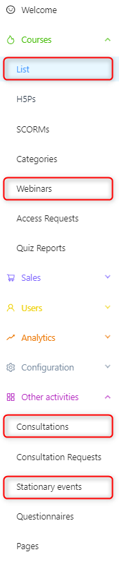
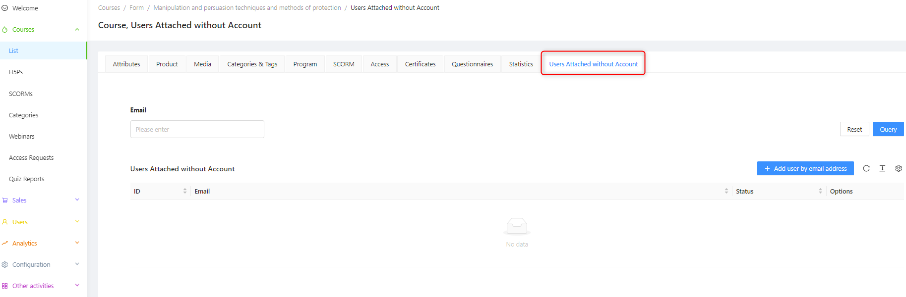
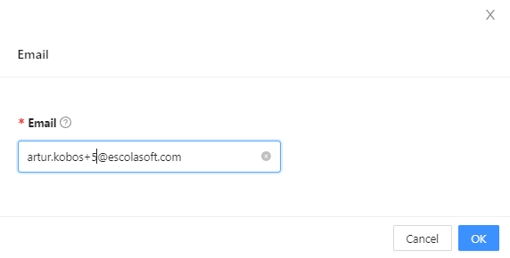
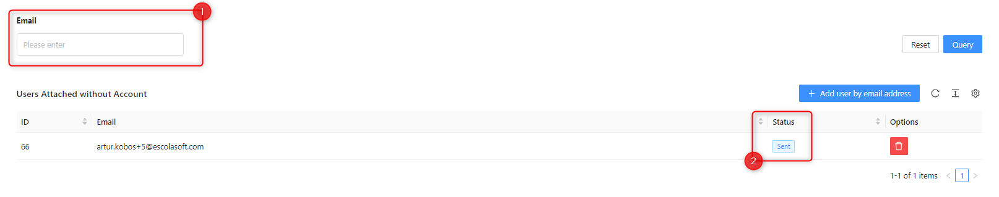

## Assign-Without-Account

You can add a user without an account to the main content modules:

* Courses
* Webinars
* Consultations
* In-person events

Inviting a user to participate in the content or event involves adding their email in the user registration element for users without an account. When creating modules, you will find the attribute **"Users Attached without Account Email"** in the attributes section. The function works the same way in each of the mentioned modules.

After adding the email of a user who does not have an account on the platform, they will gain access to the course. Additionally, they will need to create an account by clicking on the link provided before they can access the lessons. To add a user, follow these steps:

* Press the blue "+ Add User" button next to the email address field.
* In the newly appeared window, enter the email address.
* Confirm by clicking the blue "OK" button.

The added person will appear on the list for granting access to the course for users who are already registered in the system.

1. Now you can use the search filter to find the user added to the list in case the list is very long.
2. The status indicates that an email invitation has been sent to access the shared item, which will be available for viewing after creating an account on the platform using the email to which the invitation was sent.

The invited user will receive an email with a template set by the administrator in the email template panel. Then, the user must register on the front-end platform. After successful registration, they will have access to the shared items in their profile. They will not need to purchase them or request additional access. The system will remember the invited email and provide access to the content that the admin or trainer wishes to share.
