## "Users" navigation bar in the admin panel.
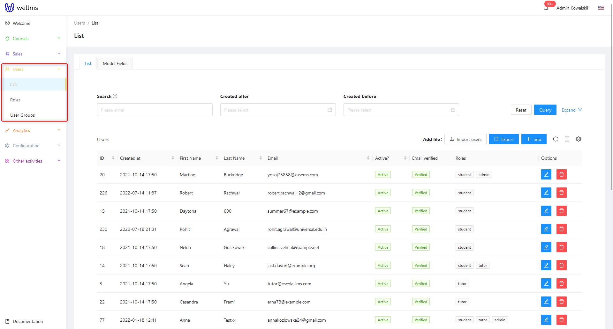
**Displaying a list of users based on criteria**

After logging in to the Admin Panel, navigate to the Users tab on the **left-hand side menu**. Above the area for the list of potential users, there are three options for displaying them: Search (?), Created After, Created Before. There are several more filters available. **To show all of them, press the blue Expand V link**.

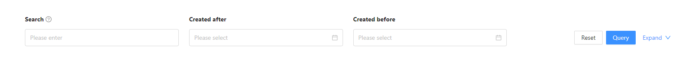

At this point, there are still additional methods of filtering user display. These include: Login last n days and Role.

**Search (?)**

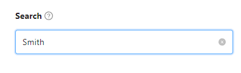

Choosing this search option allows you to find Users by a part of their first name, last name or a fragment of their email address. The Administrator will see such results on the screen after using this filter. If the searched phrase is in the first or last name of the User, they will appear on the list. If not in the first or last name, but in a part of the email address - they will also appear on the list.

**Created After i Created Before**

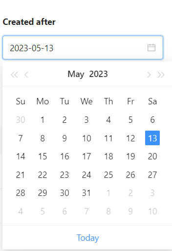

The operation principle is similar, it concerns a specific time period. In Created After, the search relates to users created AFTER the selected date from the calendar, while in Created Before, it concerns users created BEFORE the selected date from the calendar.

**Login last n days >= and <=**

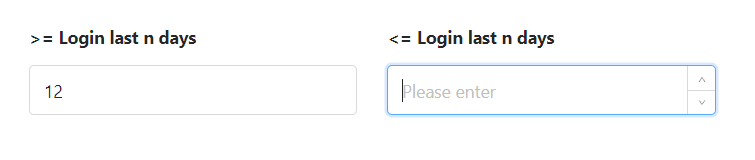

The search option allows you to enter or select with arrows the value of the number of days that have passed since the last login of the user.

**Role**

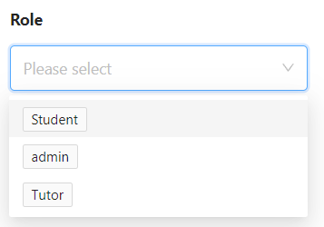

Using the drop-down list, the Administrator can select and search for users of a particular role, for example, only trainers or only students.

After selecting the desired filters, you should click on the blue "Query" button to start searching for users. If for some reason the search parameters are incorrect and need to be corrected, you can reset them by clicking the Reset button. If there are users in the database that match the search parameters, a list of results will appear below the search filters bar.

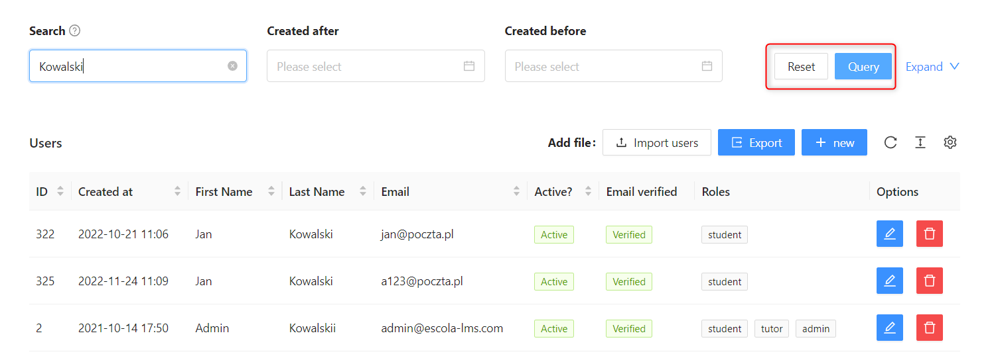

* **ID** - the number of the created User in the order of adding people in admin panel
* **Created** - the date when the account was created in admin panel
* **First Name** - the first name of the User
* **Last Name** - the last name of the User
* **Email** - the email address of the User for correspondence with the
* **Active?** - manual setting indicating whether the account is active in the system
* **Email Verified** - whether the account has been activated by clicking on the activation link or remotely activated in the admin panel (more details during User Adding and Editing)
* **Roles** - this column shows the role assigned to the User, e.g., coach.
* **Options** - the blue button  is used to **edit the User**, and the red button  is used to **delete them**.

Option to edit allows for changing all user data. It's also possible to deactivate their account using the Activation button. This option allows changing the user's role and avatar that identifies the uniqueness of the account.

Deleting a user account.

When using this option, a confirmation message will appear on the platform confirming the intended action.
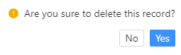

>[!WARNING]
>Clicking the "No" button will revert to the unchanged list of Users. Clicking the "Yes" button will DELETE the User from the Admin Panel and they will no longer be able to log in (as their data will no longer exist). Therefore, it is important to use this option carefully.

The options located on the right side of the screen, below the "Search" button, are also noteworthy when displaying Users.

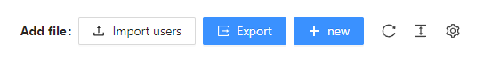

By clicking the white **"Import Users"** button, you can download and display a list of Users in Excel: csv, xlsx, xls format in the admin panel. The blue **"Export"** button allows you to download a list of Users from the admin panel to your computer in csv, xlsx, xls format.

The **"+ New"** button will be described when adding a new User because that's what it's for.

The refresh icon 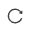 is used to update the list of Users, for example, to ensure that you are looking at up-to-date data.

This button 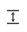 helps to make a small visual customization of the displayed list of Users in the PA. You can choose between larger, medium, and compact views. Accordingly, in the views, there are larger spaces between User table columns.

The gear icon button 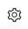, as usual, leads to additional configuration options. In this case, it allows you to personalize which User table columns the Administrator can display. You can do this by selecting and deselecting the checkboxes that appear after clicking the gear icon.

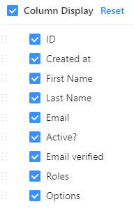

Unchecking the Displayed Rows checkbox will remove all User table fields from the view. Below is an example of a User table view with some fields unchecked:

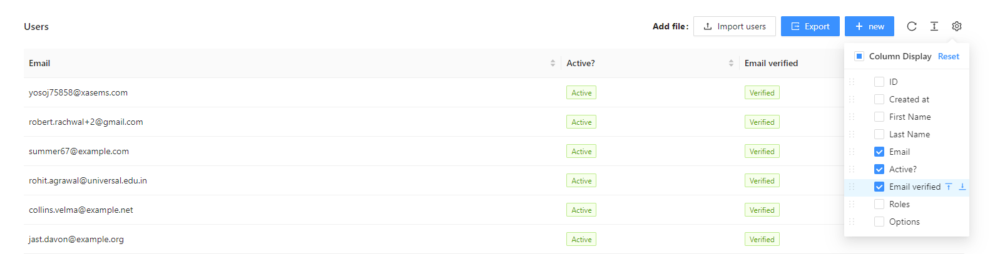

At the very bottom on the right side, there is a configuration for the number of Users displayed per page. You can change it to any desired value of the number of people.

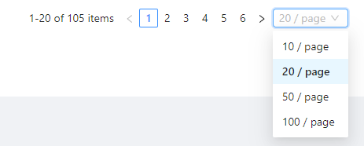

The options for displaying the number of users per page include 10, 20, 50, and 100. When there is a large number of users, additional pagination numbers are created, and clicking on a specific number takes you to that page of users.

## Add a new user.
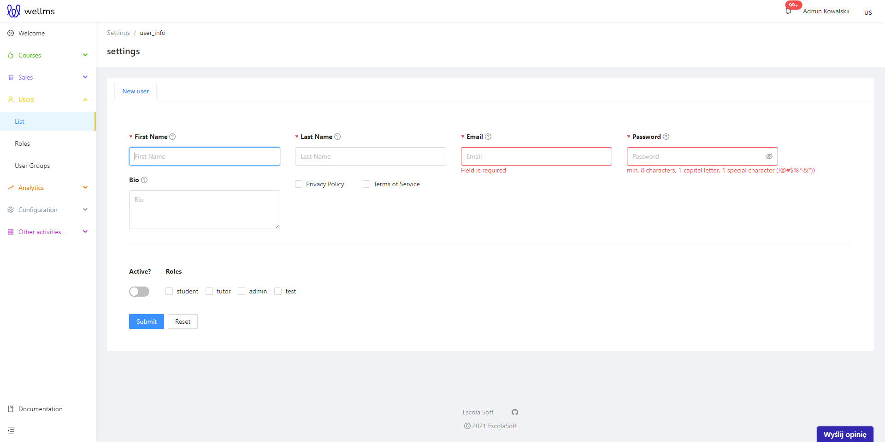

To add a new user in the Admin Panel, go to the "Users" tab and click the "Add new user" button. Then, fill out the user addition form, which consists of several fields:
* **First name:** the first name of the new user.
* **Last name:** the last name of the new user.
* **Email:** the email address of the new user, which will be used to log in to the system and to correspond with them.
* **Password:** the password that will be used by the new user to log in to the system.
* **Active?:** the setting indicating whether the new user's account should be active immediately after creation or not. If this field is checked, the account will be active; if not, the new user will need to activate their account by clicking on the link sent to their email address. After filling out the form, click the "Add user" button to save the new user in the system.
* **Role:** the role that the new user will fulfill in the system. Possible options may include student, trainer, administrator. The selection may be larger, depending on the roles created in the system by the administrator.

There may be many more fields, depending on their type specified by the administrator:
* **bio** - a short field in the Admin Panel under Users with a space for a description/biographical note.
* **Terms of Service** - agreement to the terms of use of the website
* **Privacy Policy** - agreement to the website's Privacy Policy.

After filling in the fields in the admin panel with data, you should click on the blue "Submit" button. If you need to reset and clear all entered values, you can do so by clicking on the white "Reset" button.

## Editing an existing user.
After creating a new user, the administrator still has access to the user's data. At this point, the data can be edited, which is the operation of modifying and changing it. Another option is to choose the previously described user account edit icon.

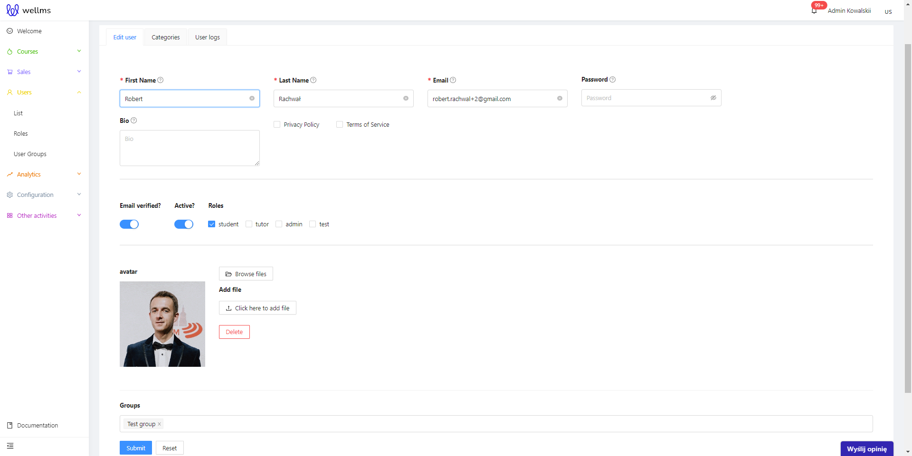

Editing a user has an identical interface to adding a new user to the platform. However, there are more options available for an existing account.

* **Verified email?** - a switch button that allows bypassing the activation process of a User's account by clicking on the registration link sent to the email. Activating this button makes the account fully active and enables access to all possible functionalities.
* **Resend** - a useful button from the perspective of helping registered Users who may complain that they did not receive the activation link - this button sends such a link again to the registered email.

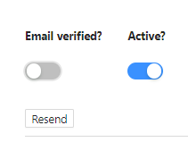

* **Below is a section for an avatar** - a graphic image that can be a photo of the person who owns the account or anything else with which the person identifies and wants to be displayed.

**Browse files** - a button for uploading an image in the admin panel that has already been uploaded in another location in the admin panel. For more information on how this works in detail, please see the Files section.

**Click here to add** - a button that allows you to add a graphic avatar to the Admin Panel from your own computer. Simply select the folder or desktop, or other location where the avatar graphic is located on the Administrator's computer. After the image is loaded onto the server, a preview will appear in the aforementioned location.

**Delete** - if the avatar does not meet expectations or the preview is not satisfactory, this button can be used to delete it and add a new one or not add one at all.

At the very bottom of the account editing sheet, there is a section to add the group to which the user should belong, or to indicate in which group they are already included if they have been added previously.

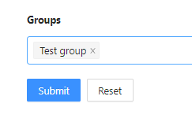

After filling in the fields in the admin panel with data, click the blue "Submit" button. If necessary, you can reset and clear all entered values using the white "Reset" button.

In the editing panel, there are also other tabs visible at the top.

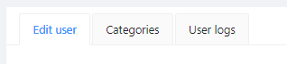

* **User Editing** - the tab where the entire editing process described above takes place.
* **Categories** - here, you can assign a category to a User. This applies only to those with the Trainer role - by setting a Category for them on the front page of the platform for their courses, webinars, consultations, and stationary events, information will appear next to their name and surname about which field they represent. The category is set by selecting the appropriate checkboxes in blue.
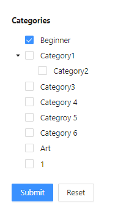
* **User Logs** - a place displaying User activities.

## Adding users to groups.
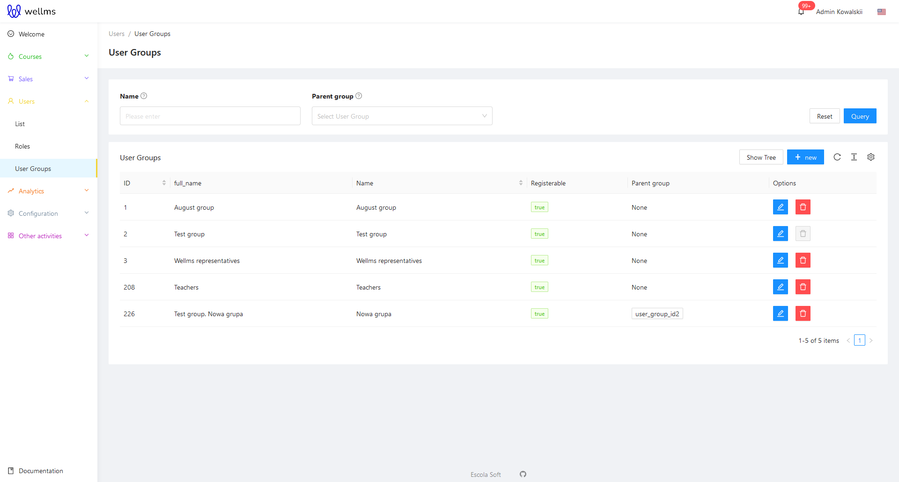

Creating user groups has **the same structure as "Users"**. The search module is located in the middle of the top of the screen. The editing and deleting options work the same as when modifying a user account. Below are two interface design differences. The option to add a new group and edit existing groups. Although they look identical to the previously discussed option, they manage the set of users.

Adding new groups, the view after clicking the **"+New"** button.
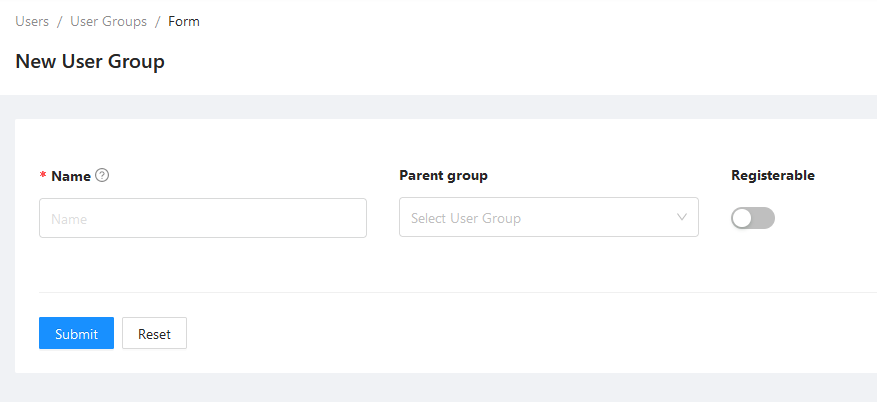

The form requires entering the Group Name, then you can assign an existing parent group on the platform. If the group does not require a parent group, leave the field blank. Clicking **"Show in registration"** enables the group to appear in the preview field. Leaving the option enabled indicates that the group is being prepared for later registration or approval.

Once the fields are completed and you click "Submit," you will be able to select users to add to the group. You can search for them by their First or Last Names.
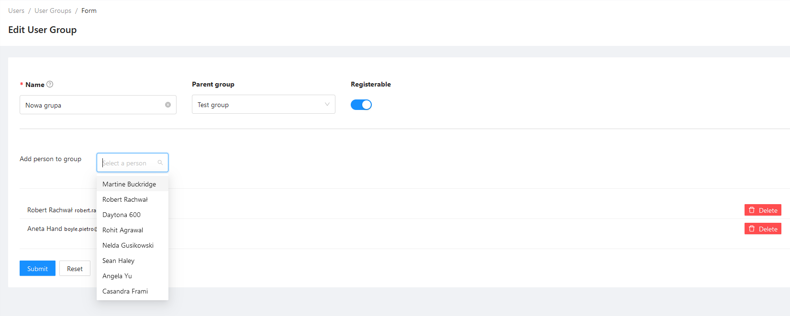

In case of adding a wrong user to the group, you can remove them by using the **"Delete** button on the right side of the screen. The removal option does not provide additional information for quick group management. If you accidentally remove a user, search for them again and add them back.

## Adding an account from the admin panel and setting up registration for the platform.
If something is not working properly with account registration, you should verify the platform settings in the configuration and registration options tabs.

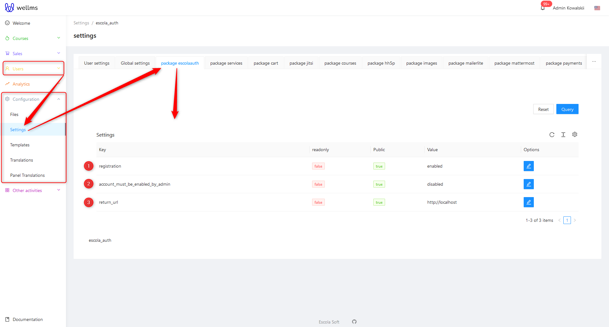

1. Is registration required on our platform?

2. The account must be enabled by the administrator.

3. Creating an account requires proper configuration in the admin panel. This means that setting the return_url is required.

