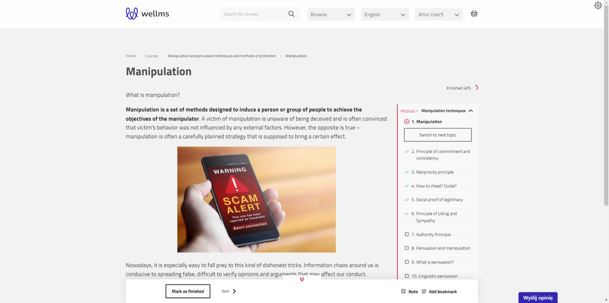
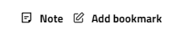
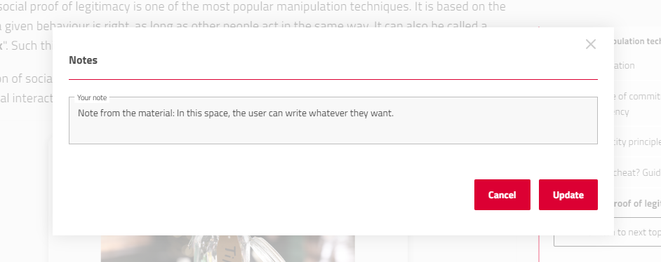
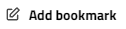
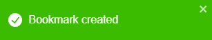
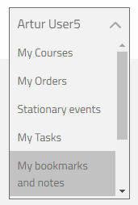
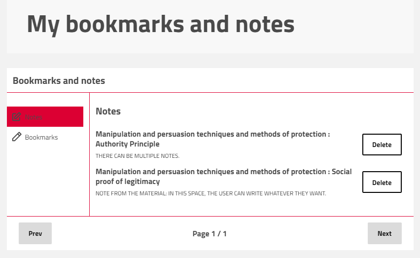

## Bookmarks-Notes

The discussed feature is located on the front page of the platform. It is primarily used by platform users to make notes and bookmarks within a course. Starting from the beginning, the user logs in to the front page of the platform.

Inside the course, the user will have a visible toolbar at the bottom of the screen, which includes a notepad and an option to add bookmarks.

The user can write an individual note in each of the topics. Notes are visible only to the person creating them. When returning to the topic at a later time, the note will still be accessible.

By clicking the "Update" button, you can overwrite the existing note with additional content. Alternatively, you can delete the note's content and save an empty notepad.

The second button  is used to add a bookmark to an interesting topic within the lesson.

After adding a bookmark, you will receive a success message at the top of the screen.

To view your saved notes and bookmarks, you need to access your user profile and go to the Notes and Bookmarks section.

The notes and bookmarks screen looks like this:

You will find all your saved notes and bookmarks organized in this section.

The course and topic titles allow for quick switching to the saved note or bookmark. Alternatively, on the right side, you can delete unnecessary notes/bookmarks.

After deleting a note or bookmark, a confirmation message will appear indicating successful deletion.

