## General shop management

Discussion of sales-related functions:

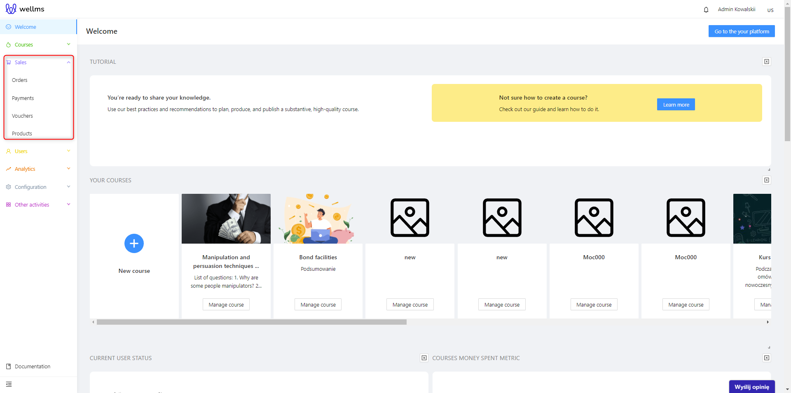

**Orders**
After filtering by calendar (date range from and to), product name, or platform user, you can review the order history here, including their status and details such as the amount, exact date of the transaction, etc.

**Payments**
By filtering through the calendar (date range from and to), status, or the option of who the invoice should be created for, similar to the Orders tab, you can view the details of payments processed in the admin panel when a customer makes a purchase of courses, webinars, consultations, etc.

**Vouchers**
These are discounts that can be applied to individual courses or product bundles. More information on this topic is available in a separate section dedicated solely to Vouchers.

**Products**
This is the general category of ALL items eligible for purchase. This means that a created product is something that can be bought (or redeemed for free if it has a price of 0 PLN) and transactions can be carried out through the shopping cart and payments. When adding a course, webinar, or consultation, the administrator has the ability to declare the existence of the aforementioned items as things available for customers to acquire through the Product tab.

## Orders

The Orders tab is located in the expanded Sales list in the menu on the left side. In this section, you can review the list of orders made on the platform.
The view after clicking on Orders looks as follows:

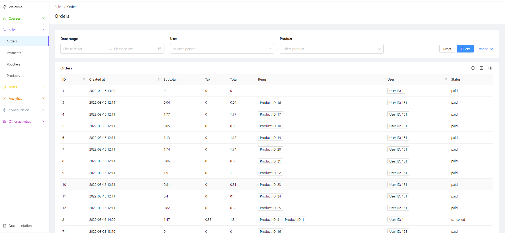

Displaying the list of Orders based on criteria:

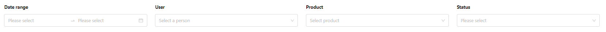

In the Orders tab, there are four options available for filtering the list when you expand the "Expand" section. The options include Date Range, User, Product, and Status.

The Date Range option allows you to view the order history within a specific time range (e.g., the last three weeks).

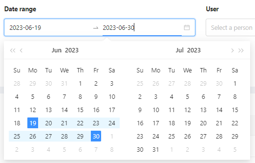

The User option displays the order history of a specific platform user.

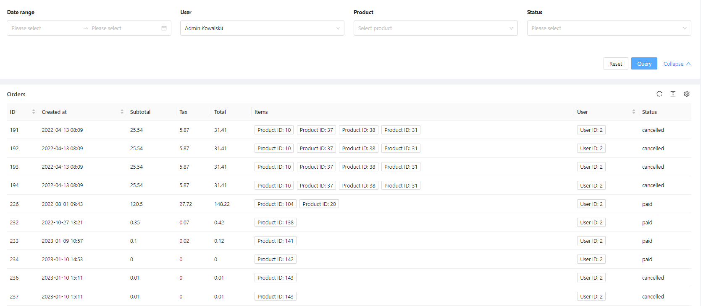

The Product option shows the order history of a specific purchased product.

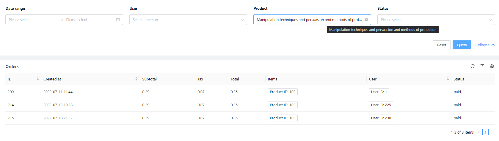

The Status filter allows you to search for orders based on their status.

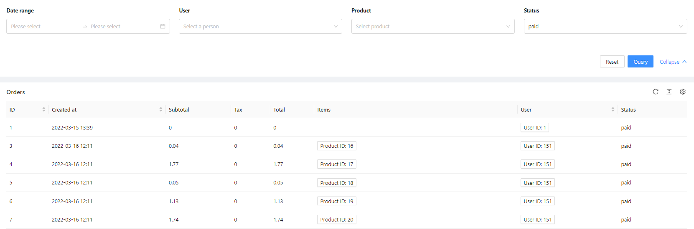

The white Reset button clears the filter fields and shows all groups. The blue Query button initiates the search based on the specified filter parameters. 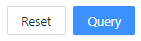

In the Orders view, the following categories are displayed:

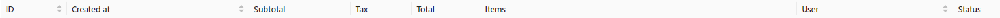

* ID: The order number
* Created: The date when the order was created
* Subtotal: The net amount paid for the product
* Tax: The VAT tax rate (already provided in PLN, not as a percentage)
* Total: The gross amount paid for the product
* Items: Displays a clickable button with the Product ID: X, indicating the purchased product

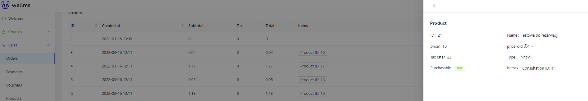

* User: Similar to the above, it displays a button with the User ID who made the purchase

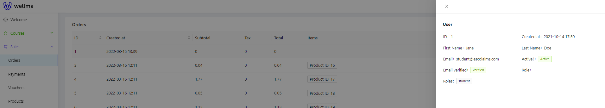

* Status: It can have values of **PAID** and **CANCELLED**

## Payments

The next tab after Orders is Payments. In this section, you can review the list of payments made within the platform system.

The view after clicking on Payments is as follows:

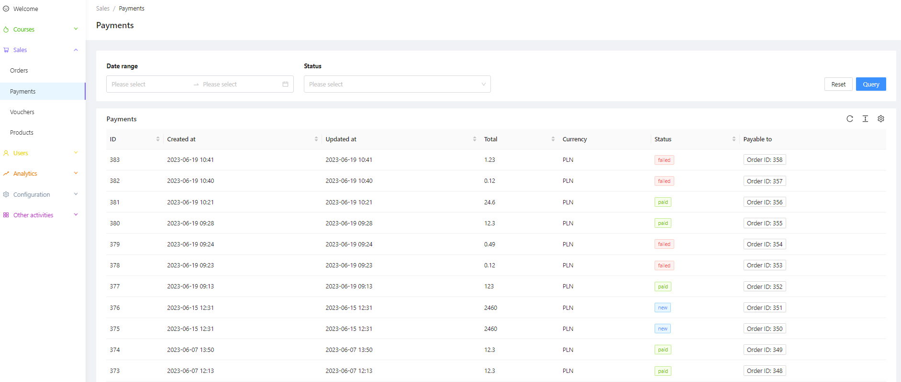

The window is quite similar to the Users and Orders windows.

The Date Range - as mentioned above, allows setting a time range, specifically for payments.

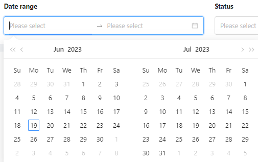

Status - we distinguish five statuses: new, paid, canceled, failed, redirect.

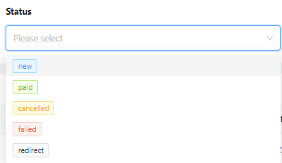

Additionally, it is possible to sort the results in ascending or descending order using small arrows next to the Payment categories. The categories in Payments are:
* ID - assigned payment number
* Created - date of registering the payment in the admin panel
* Updated - any updates made to this payment on a specific date
* Amount - the nominal amount of the payment
* Currency - the currency name (e.g., PLN, USD)
* Status - can take the values "paid" or "redirect"
* Paid For - indicates the path to which product the payment belongs. Clickable button with the ID of the product for which the payment was made.

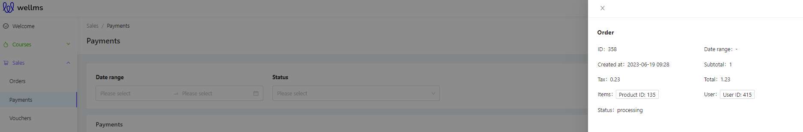

## Products

Displaying a list of Products based on criteria

After logging into the Admin Panel, navigate to the Products tab in the left sidebar menu.

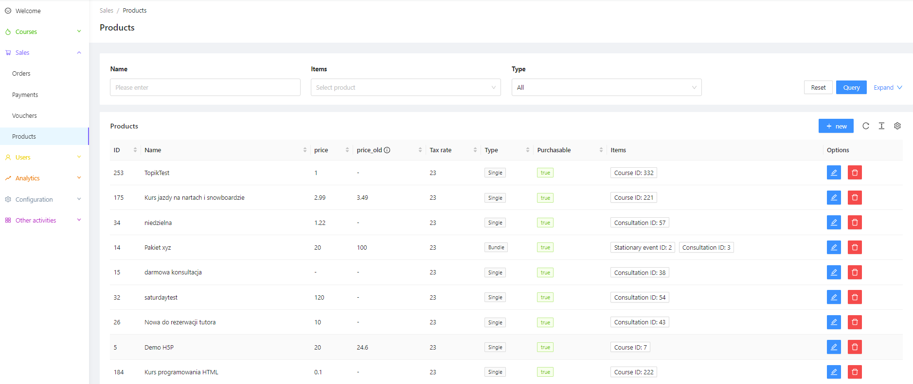

Above the area for the list of potential products, there are three display options: Name, Item, Type. There are two additional filters - For Sale and Free. To show them, simply click on the blue "Show more" link.

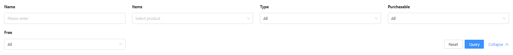

Name - this filter works similarly, searching for products containing the entered phrase.
Item - it searches for a specific product from the list based on which PACKAGE it belongs to. We will discuss what a package is in a moment.
Type - it allows filtering either individual products or packages that contain products.
For Sale - it takes values True and False. If a product is added and marked as For Sale in its properties, it should appear on the list when filtering by True.
Free - it also takes values True and False. If no price is specified, the product is considered free and will be displayed when filtered by True.

A single product record is presented as follows:

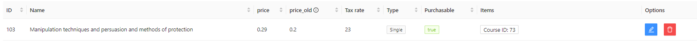

* ID, Name - function in the same way as discussed earlier, representing the sequential number of the item and its name.
* Price - the current price of the product.
* Old Price (strikethrough) - an option mentioned during the creation of a Course. It is used to present the product as a promotion after a price reduction.
* Tax Rate - indicates the percentage of VAT included in the product. VAT can be changed to any legally required value.
* Type - takes the value of Single or Package.
* For Sale - discussed above in relation to filters - shows whether the product is available for purchase by customers.
* Items - IDs assigned to a particular product, such as Webinar ID, Course ID, etc.
* Options - editing and deleting products.

## Creating a new product

To add a new product, click on the blue "+ New" button 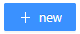. However, the Admin Panel is designed in such a way that it is much more convenient to add a new Course, Webinar, Consultation, etc. and then the option to add it as a product will appear after confirming such an educational element (it's called a widget - a kind of shortcut in the program).

The process of adding a new product follows a similar structure as described earlier for Courses:

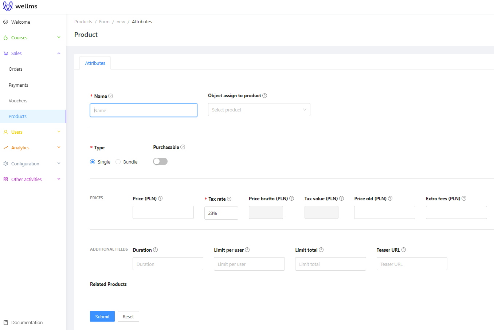

If we add a product from this place instead of using the widget when directly adding a Course, Consultation, etc., there is a new option called "Object assigned to the product." From the list, we can select the educational element that will become a purchasable product.

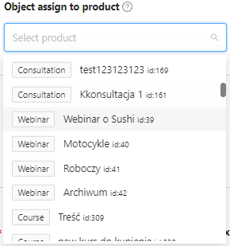

After adding multiple individual products to a product bundle, you will see a list of items at the bottom that provides their ID, Name, Type, and the optional quantity that can be set for each item in the bundle.

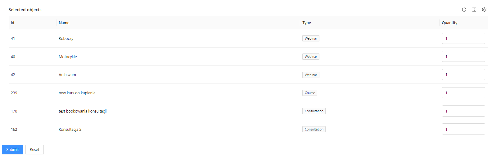

The rest of the options are filled out similarly to what was described for the predefined Course. After confirmation, additional tabs will appear, including "Media for the Cart," "Product Categories and Tags," "User Enrollment," "Save User Without an Account," and "Templates." These options are already familiar to us as they were discussed in the context of Courses.

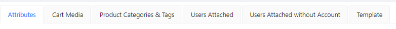

When you want to edit an existing product, you can click on the blue edit button . The form for editing the product is filled out in the same way as setting the price for an individual item. You can update the product details, such as its name, type, price, tax rate, and other relevant information. The editing process for a product follows the same format as when creating a new product, allowing you to make any necessary changes to the product's configuration.
