## Categories

After logging in to the Admin Panel, you need to go to the "Courses" dropdown tab on the left side menu and select "Categories" from the menu.

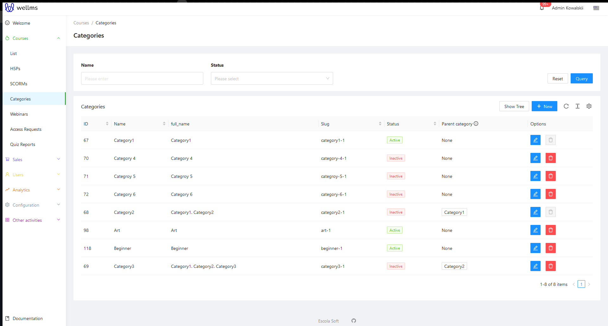

Categories can be filtered using the name entered in the first filter on the left-hand side. The second option is to filter the active/inactive status of the categories.

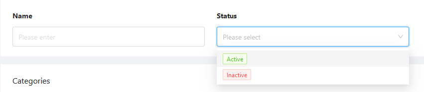

Under the filters, there is a list of categories along with sorting options.

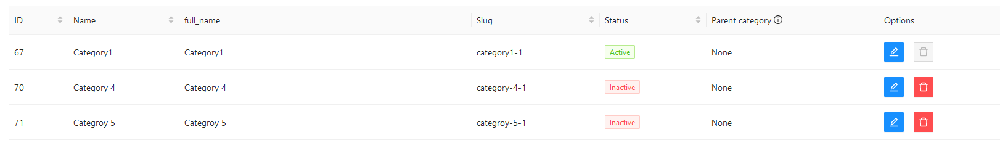

* ID, Name - as always, the sequential number of creation and the title.

* Full name - for the so-called Parent category it is, for example: Marketing. For a Subcategory, it looks like: Marketing.Subcategory_of_Marketing.

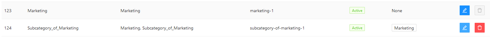

* Slug - a special display of the name as a part of the link on the website, to make it readable and aesthetic. This option is non-editable, the system generates it.

* Status - Active / Inactive, works in a similar way.

* Parent category - for the Parent category, it displays: None. For a Subcategory, it displays the name of the Parent category.

* Options - edit and delete category. Parent categories cannot be deleted.

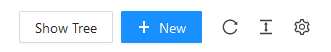

Above the options, we can also view the category and subcategory tree if we have multiple branches, which will be organized in the tree. Next to it, there is the option to add a new category and the options for refreshing and modifying the category sorting list.

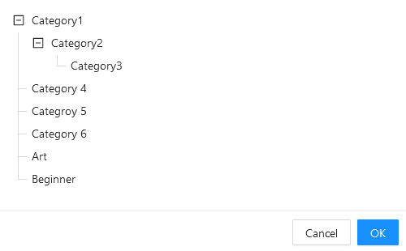

To add a new Category, click on the blue button **+New**.

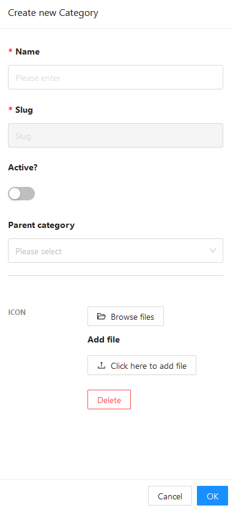

The name will be used for searching for courses, **so it is worth considering what category of courses to use in terms of naming**. 

The slug is a unique string of characters and is automatically set based on the entered name. It is used by the platform to find and search for courses to which the created category will be added later. 

**It is important to check the "Active" button**, leaving this field disabled will prevent the category from being searchable. Only after activation, it will be possible to search for it by users. 

At the bottom, you can add a previously created parent category for which the currently created category will be a subcategory. 

After clicking the OK button, the category will be available for selection in courses.

The category icon can be added only during the editing of the already created category. That means adding an icon to a new, not yet created category will fail because it must be saved first.

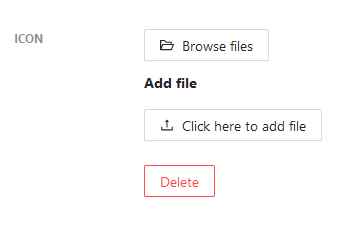

>[!WARNING]
>Categories are used throughout the platform. They are used to mark courses, webinars, consultations, offline events, as well as to create categories of users, trainers, such as Marketers, Entrepreneurs, etc.

## Example selection of category in course and user.

Categories in a course are selected in the course attributes, in the "Category and Tags" tab. All categories created by us with the information described above are there.

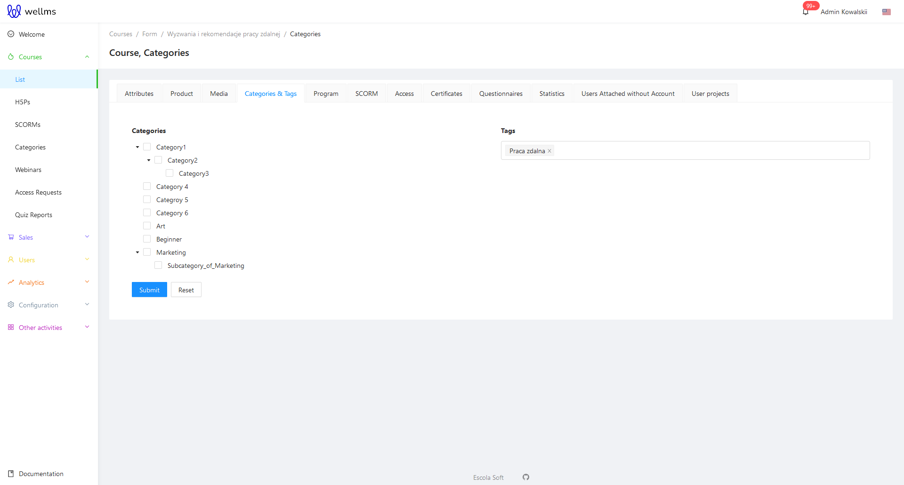

We select the category we're interested in from the selection field and click the blue Submit button to confirm the category selection for the given course.

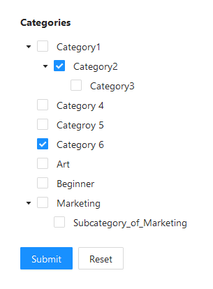

Similarly, when selecting categories for a user, we do it in the user's editing panel. We can assign an existing category to any account.

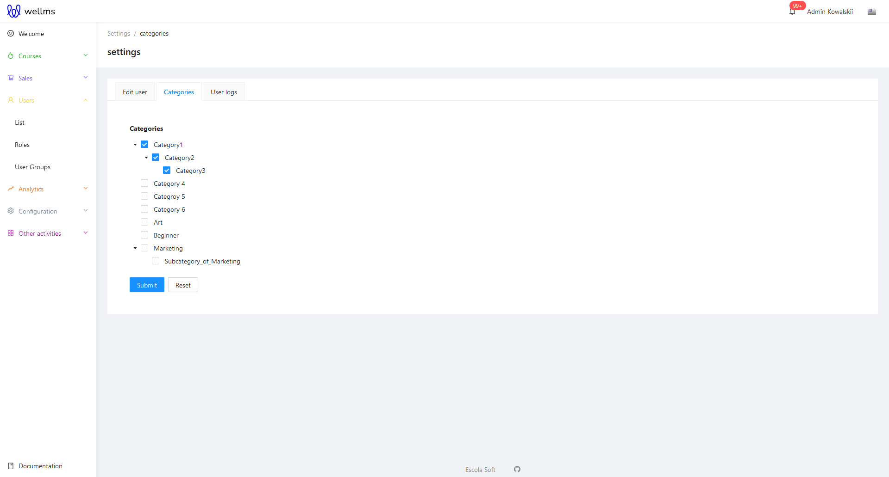

## Searching for a course by category.

The following is a search on the Front Page of the platform by the end user. The user can search for course collections based on the categories they are interested in. The elements have links that allow users to navigate between different types of searched content using categories.
