## Consultations

Displaying a list of consultations based on criteria. After logging in to the Admin Panel, go to the Consultations tab in the left-side menu. Above the space for the list of potential consultations, you can see three options for displaying them: Date Range, Name, Categories.

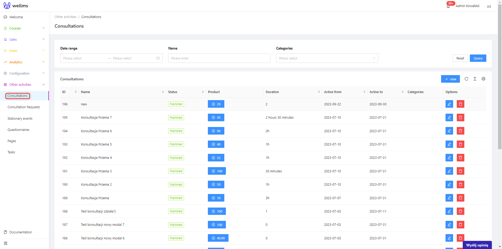

All filters work in the same way as previously described.
A single consultation record looks like this:

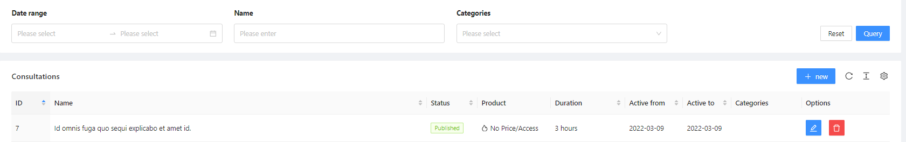

We can see many familiar options and names similar to the Courses view.
* ID - the assigned number for the consultation
* Name - the name of the consultation
* Status - 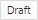, 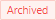, and 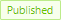, similar to the statuses in Courses. An additional status.
* Duration - values can be in minutes or hours. It is recommended that the consultation lasts for one clock hour, but it can also be longer.
* Active From - the date from which the consultations are active and available for purchase on the frontend platform.
* Active Until - the date until which the consultations are active and available for purchase on the frontend platform.
* Categories - assigned during the creation of the consultation in the tab of the same name, following the mechanics mentioned during the course creation phase.

## Adding a new consultation

You can add a new consultation by clicking on the blue button labeled .

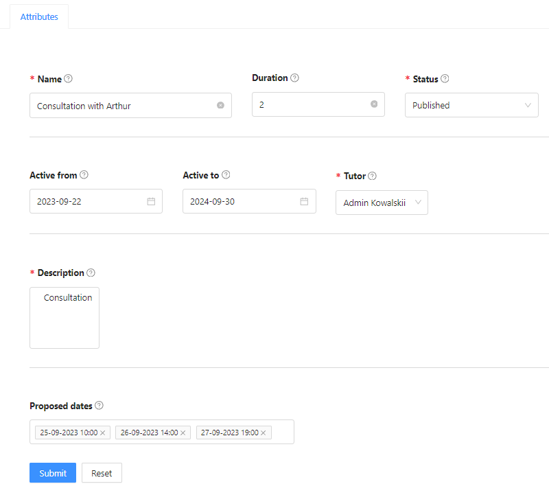

Creating a new consultation is straightforward. You need to enter:

* Name (mandatory) - the name of the consultation (usually, this can be the topic being discussed or even the name of the person who will be the trainer).
* Duration - in accordance with the rules described above when discussing this field.
* Status - there are three options to choose from: draft, archived, and published.
* Active from and Active to - as explained earlier when discussing the consultation record table. A date picker appears, and you can set the time frame during which the consultation will be available.
* Trainer (mandatory) - start typing the first and last name of the user with the role of a trainer. Consultations must have a designated trainer, i.e., a person who will conduct the conversation with the student. If such a user with the role of a trainer already exists in the database, click on their name and add them as the trainer of the consultation.
* Description - in this section, you should present the consultation to clients - what it's about, who the facilitator is, what the goal is, and what topics can be discussed in such an online conversation with the trainer. It's a good idea to format everything using formatting methods described in the Formatting in Longer Text Fields subsection.
>[!WARNING]
>The "Proposed Dates" feature works when setting up a product package. If it's a single consultation, it allows users to sign up for any available meeting time regardless of the entered date. For a single consultation, the trainer can either accept, reject, or propose an alternative time. This field is significant for consultation packages with a master meeting date.
* Proposed dates - this is an important calendar for limiting situations, such as clients not scheduling appointments at odd hours. You can set a "schedule" for which days and times the trainer is available for a particular consultation. Not filling in this field means the trainer will be available for consultations 24/7.

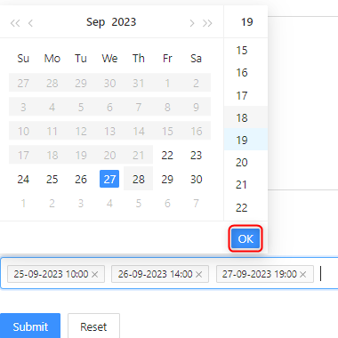

Upon confirming the addition of a new consultation, additional tabs appear, just like with courses. Some of them are repeated, so they will be skipped. You'll also notice that you are immediately in edit mode for your new consultation.

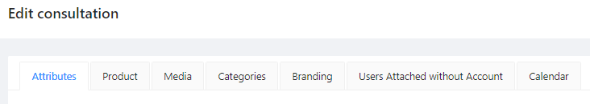

* Product, Media, and Categories - these tabs function similarly to courses and should not pose a significant challenge.
* Branding - this is a new tab, but it operates on a very simple principle. If your trainer has their own logo or works on behalf of a known company, you can upload a graphic file with the logo in the *svg format, and it will be visible during consultations in the conversation window on the left side at the top.
* Saving a User Without an Account - we have already discussed this mechanism during the course creation phase.
* Calendar - this tab provides a detailed calendar view of when a consultation is scheduled to take place or has already occurred. It is an important feature for trainers to keep track of the schedules of numerous consultations.

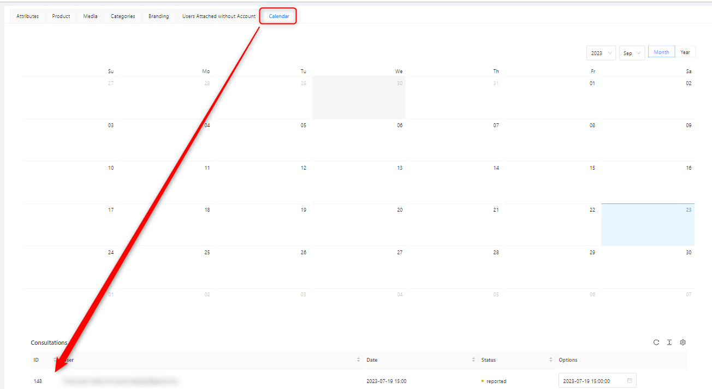

## How does it work in practice?

# User View.

An example on the simplest template of the platform's front end looks like this:
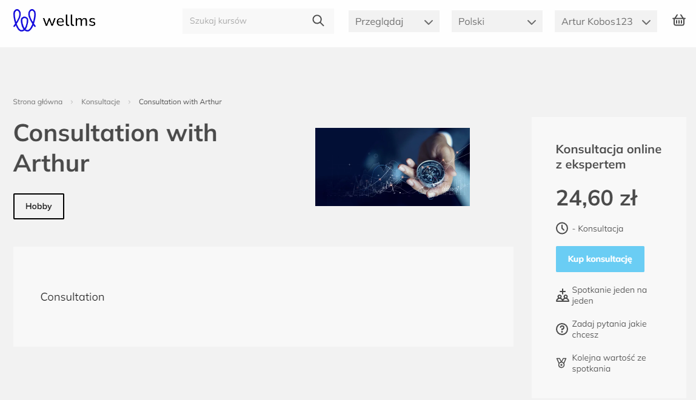

A logged-in user searches for a consultation on the platform and purchases it. Then, after making the purchase, they go to their profile and navigate to the "Owned Consultations" tab. There, they can find the purchased consultation and schedule a meeting with the trainer.

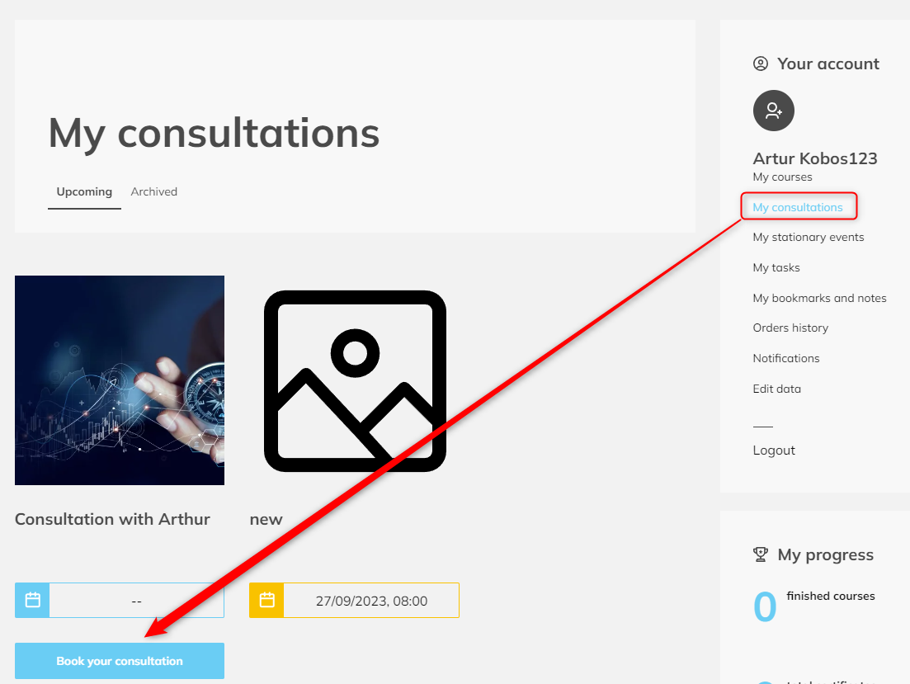

After clicking the save button, a meeting calendar will appear:

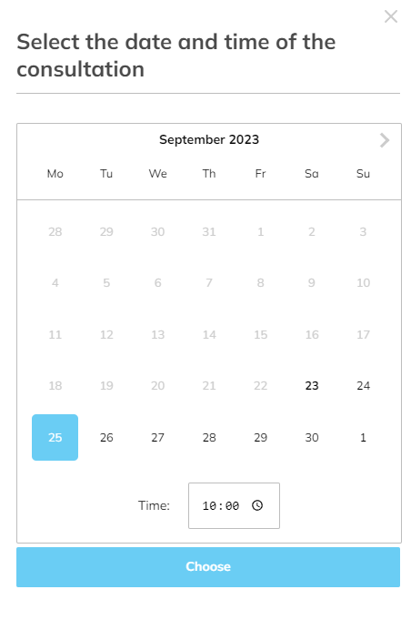

After clicking the "Choose" button:

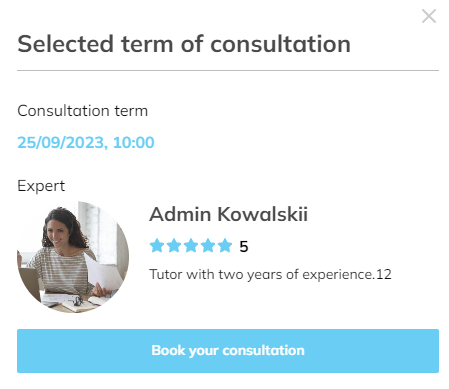

After a successful reservation, a message will appear:

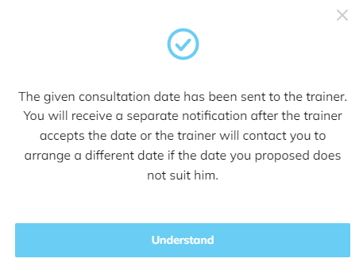

And the time slot beneath the consultation will be highlighted in yellow, indicating that it's pending approval or rejection by the trainer.

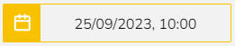

# Trainer View.

The trainer in the admin panel sees the reserved meeting and can either accept it or change the date/time of the meeting and then send the acceptance.

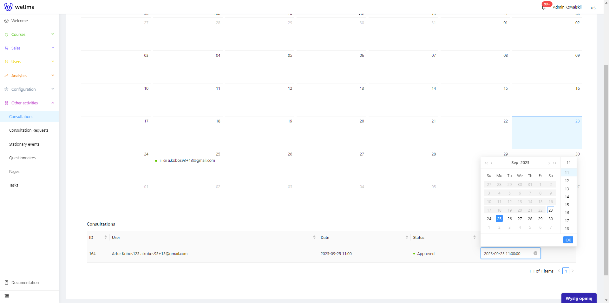

After the trainer accepts the appointment, the user sees the status changed to green, along with the updated time. Of course, the user can also propose another day and time, repeating the process until a suitable time for both the trainer and the user is found.

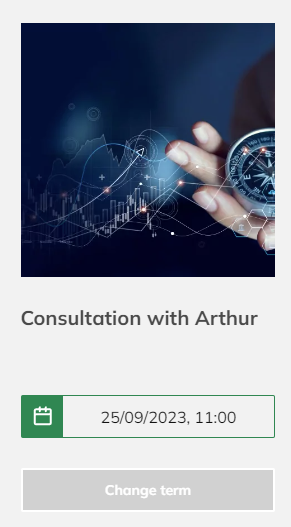

