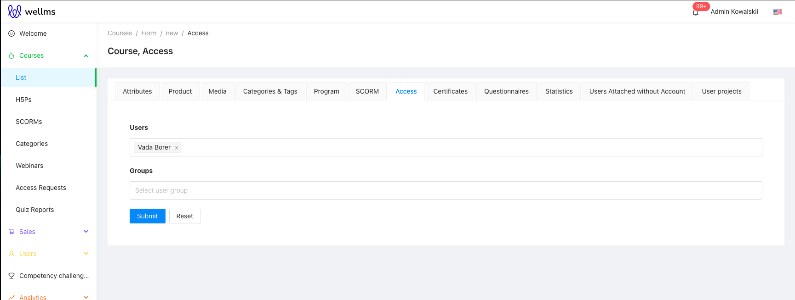
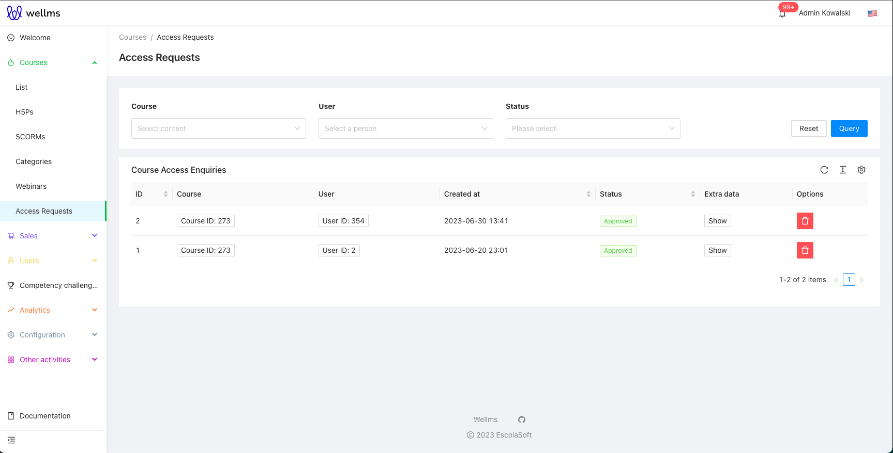
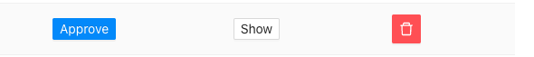
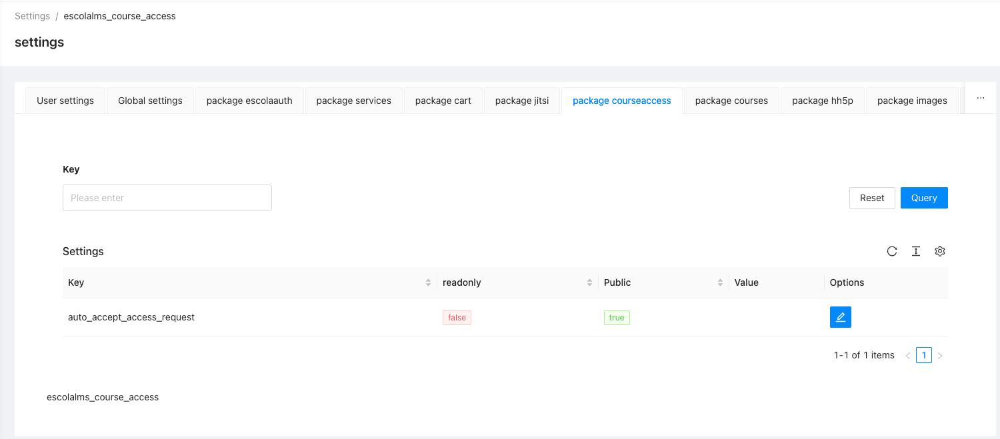
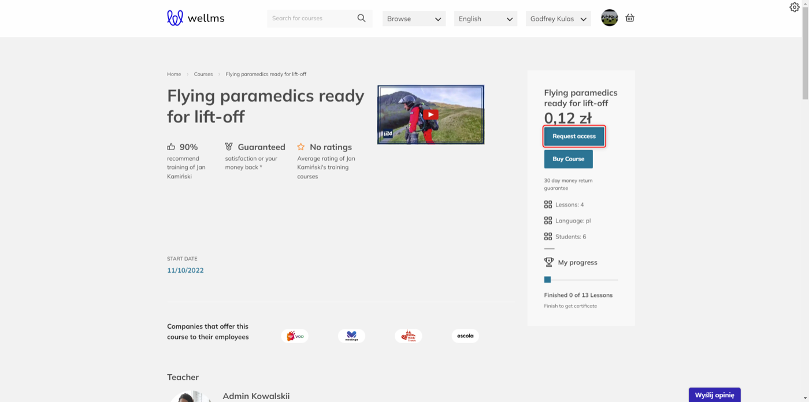
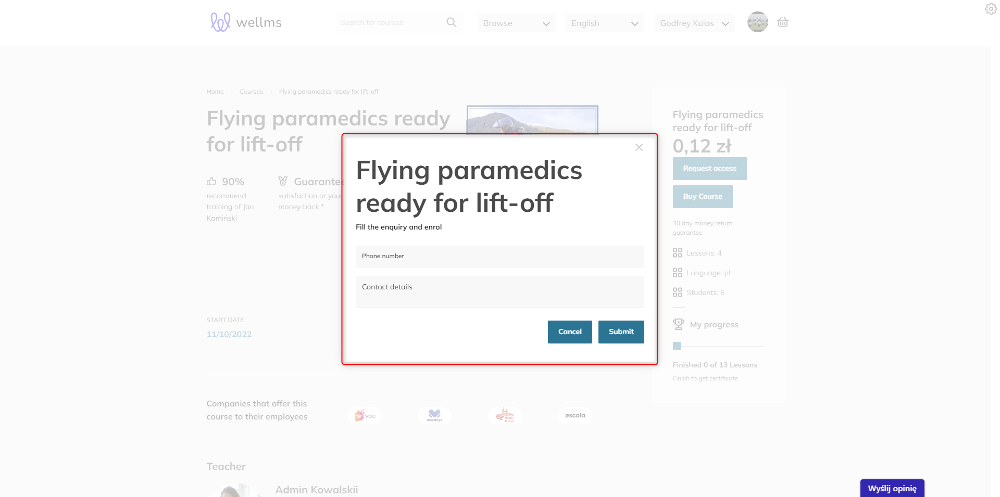
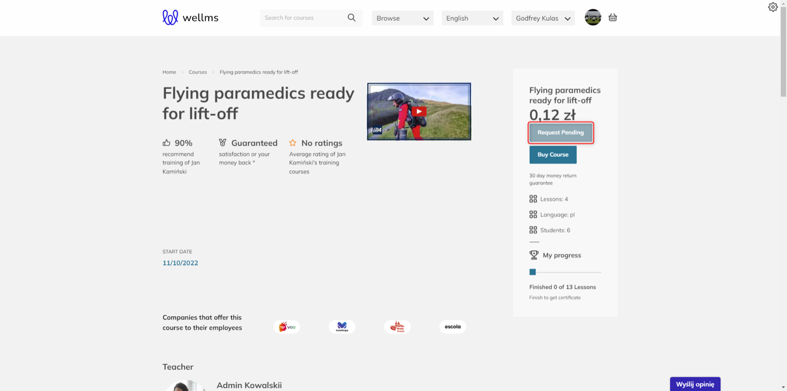

# Admin panel documentation

The Course Access package is designed to handle access management for courses.
It provides a set of functions that are used both in the Admin Panel and on the Front App.

## Course Access

In the course details, there is an "Access" tab.
In this section, you can both grant and revoke access to the course to individual users, as well as groups of users.

## Access Requests

To manage access requests submitted by users for the course, there is a separate tab called "Access Requests."
Within it, you will find user information, course details, and extra data.

Clicking the "Approve" button grants access to the user for the course.
You can also remove the request.

In the Settings tab, you will find an option that allows all requests submitted by users to be automatically approved.

Automation can be used in the case of providing free access to a course, requiring only a request for course access. If we do not set the automatic function in the options, all course access requests must be approved by authorized individuals.

## Access to the course from the user's perspective.

The view of a access request from the Frontend of the platform looks as follows:

Please note that the user must be logged into the Frontend of the platform for the access request button to be visible in the course selection panel.

The user can leave additional information that will allow the access-granting person to have additional contact or information justifying the request for course access.

After filling in the contact information, the button changes to a message indicating that the access request has been sent. At this point, the person authorized to grant access can either accept or reject the access request.

