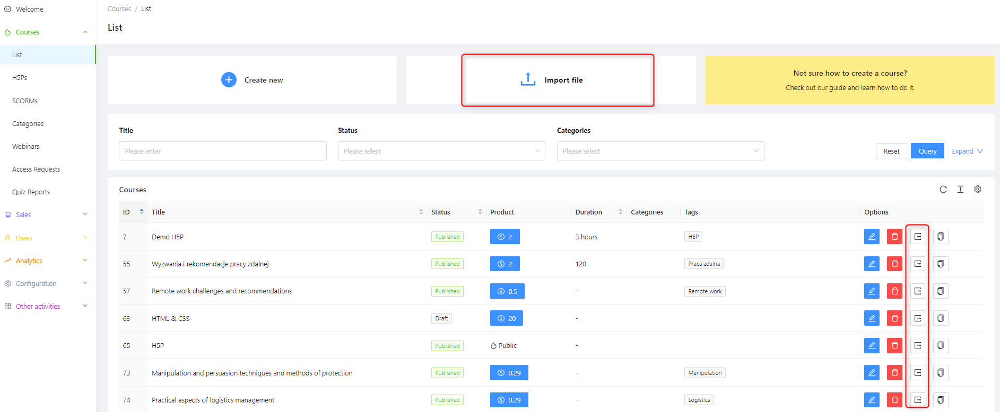
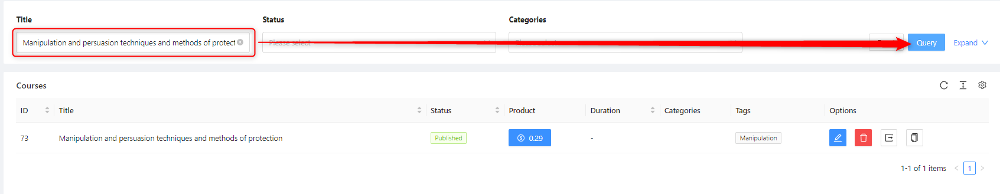
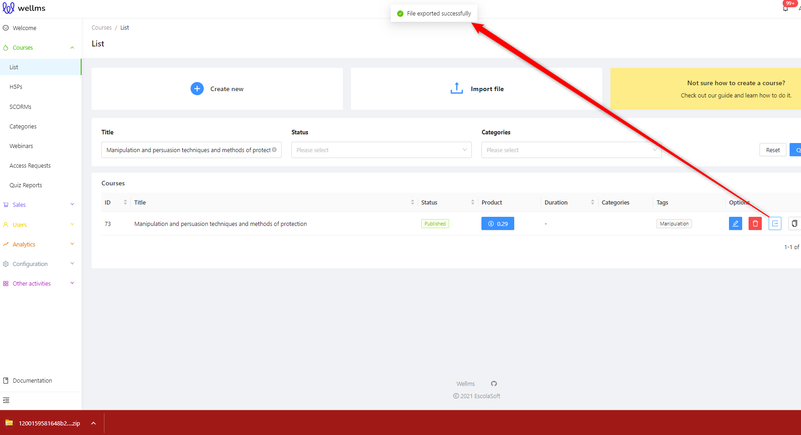
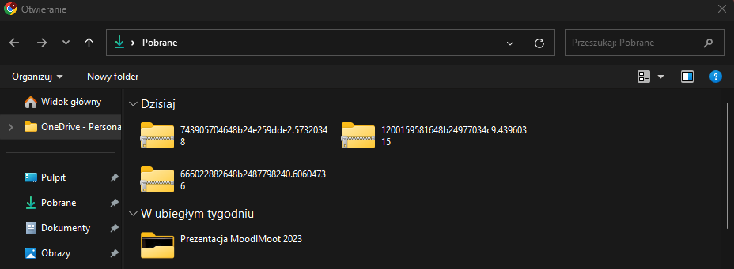
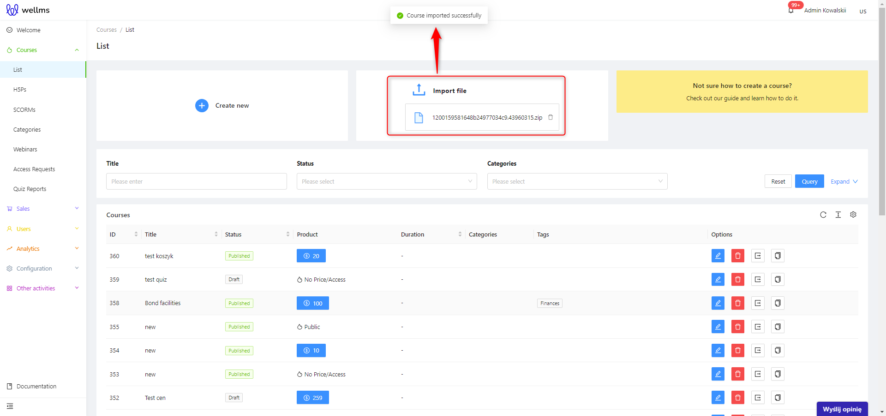
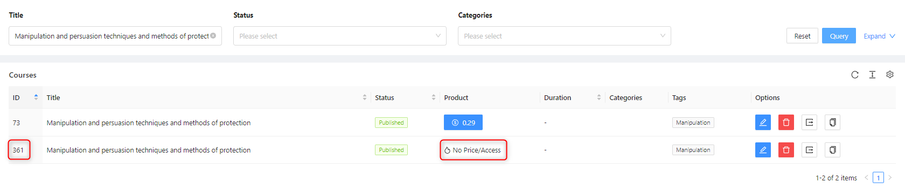

## Courses-Import-Export

Exporting and importing courses is possible in the **Course - List** section. An already created course can be exported from the platform to a device. Then, the course can be imported, either from a stored file on the disk or transferred between different admin panels of the Ulams platform.

Let's start with exporting an existing course. Then, we will move on to the import process.
**Step one: **Locate the course you want to export using filters or sorting options.

Step two: After locating the course, click on the button on the right side in the Options section 

At the top of the screen, a message "File exported successfully" appears, and the course is downloaded as a ZIP package to the disk.

>[!WARNING]
>Please note that if the file is not downloading, it is possible that you have a browser setting that blocks downloaded files. Another possible reason could be a very large course size, as the download speed depends on your internet connection. The more video files in the course, the longer the download may take.

Importing is even easier than exporting. In this case, simply click on the "Import file" button.

After clicking, a file selection window will open, from which you can choose the course to import onto the platform.

After selecting the file, the import to the platform will start immediately. Please remember that the import speed depends on two factors: the size of the imported file and the internet connection speed you have.

When the message "Course imported successfully" appears, the imported course will appear on the list. You can distinguish it from the existing courses by the absence of a price and ID.

The imported course will not have a set duration or price by default. These are attribute factors that need to be set again. However, all the texts, images, videos, links, PDFs, and H5P interactions will be transferred. The same applies to categories and tags.

>[!WARNING]
>The most common issue during import and export is related to the internet connection. Make sure you have a stable connection, preferably a wired one. If you are using Wi-Fi, try to get closer to the router for a stronger signal. In case of any failures, refresh the browser page while ensuring that you are logged in. For very large files, wait for a moment after the import and also refresh the platform if the course doesn't appear immediately.
