## "Courses" navigation bar in the admin panel.

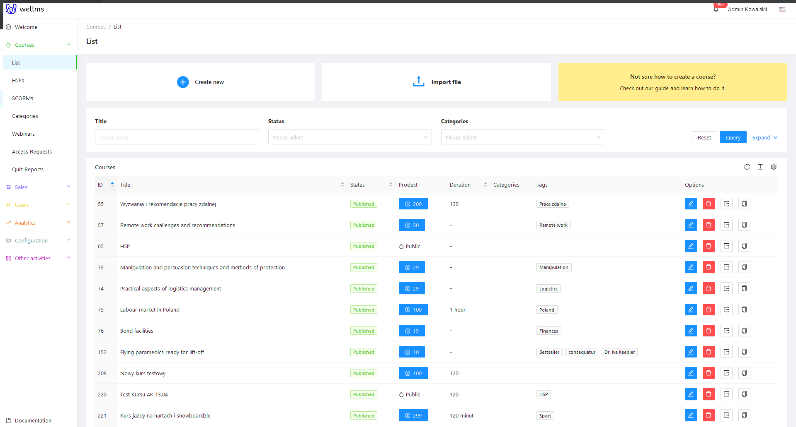

After logging into the Admin Panel, you need to navigate to the "Courses" tab in the left sidebar menu and select "List." Above the area where the list of potential courses is displayed, you will see three options for sorting them: Title, Status, Categories. There is an additional filter called "Tags." To show this filter, click on the blue "Expand V" link.

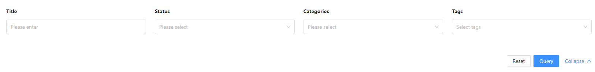

**Title**

Selecting this search option allows you to find a course by part of its title. This is the result that an Administrator/Trainer will see on the screen after using this filter. If the search phrase matches the course title, it will be displayed on the list.

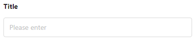

**Status**

Displays courses based on the status assigned to them in the admin panel. There are three possible statuses: **Draft, Archived, Published**.

* Draft - The course is visible in the admin panel but not on the front-end of the website. It can be modified and changed freely, and then set to a different status, such as Published, when its designated date arrives.

* Archived - This status is used for courses that have already taken place and ended. They can be "resumed" and brought back to the front-end as a reactivation at any time.

* Published - The course is visible on the front-end for users. It is recommended that courses with this status be complete, with well-developed content and no empty sections. Therefore, it is advisable to use the Draft status mentioned above before adding a course.

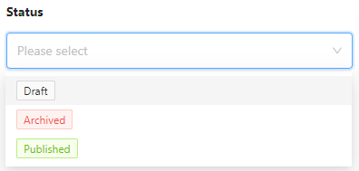

**Categories**

From the dropdown list, you can select the category to which a particular course belongs. More information about editing categories can be found in the chapter with the same title.

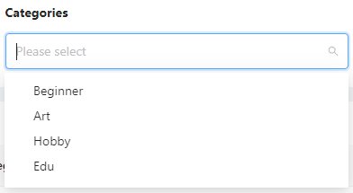

**Tags**

This works somewhat similar to categories. We enter keywords in the search bar, such as "bank," "credit," "interest rate." The admin panel will find all courses that are assigned these specific tags (keywords).

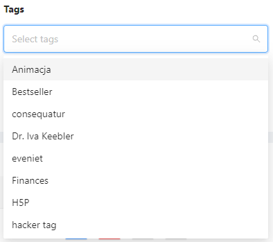

After selecting the desired filters, click the blue button to initiate the course search. If, for any reason, the search parameters are incorrect and need to be corrected, you can reset them by clicking the Reset button.

If there are courses in the database that match the search parameters, a list of results will appear below the search filter bar.

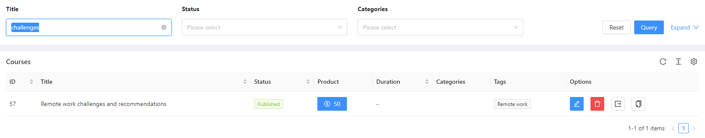

The course sorting view on the list consists of:

* ID - the sequential number for the created course
* Title - the title of the created course
* Status - its status, as discussed above with the three statuses.
* Product - the price of the purchased course, visible to the customer on the front end.
* Duration - how long the course will last. It can be specified in hours, minutes, or days.
* Categories - as described above during category-based search, it displays the course's category affiliation.
* Tags - a similar situation as with categories, it also displays the keywords associated with the course.
* Options -  they take the form of icons next to each entry. The first two are used for editing and deleting courses, similar to how it works with users. The icon  allows exporting the course as a compressed *zip file to the admin's computer. The icon 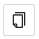 allows cloning the course to create an identical duplicate. This process takes a moment, and then we have two identical courses, each with a unique ID.

The three familiar icons, just like in the case of Users, are used for refreshing (reloading), increasing the spacing in the sorting list, and enabling/disabling columns in the list.

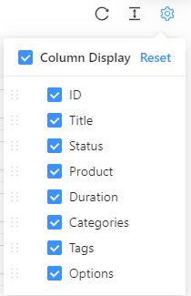

At the top, there is a blue Import File button, which is used to upload a *zip file package to the platform. This allows us to import a file from our computer.

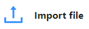

View of a successfully imported file:

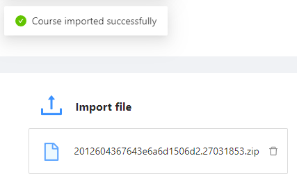

The "+ Create new" button is used to create a new course.

## Add a new courses.

The "+ Create new" button allows you to create a new course. As mentioned earlier, this can be done from the List tab or the Dashboard by clicking the blue "+ Create new" or "+ New Course" button. This will open a form in the Administrator panel where you need to provide the necessary information to add a new course to the system:

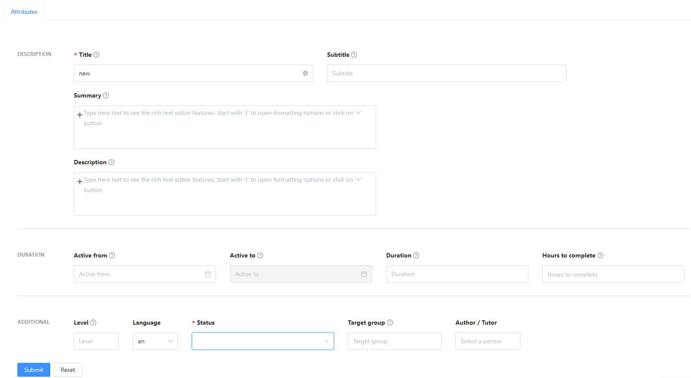

>[!WARNING]
>The visible attributes may vary in terms of their placement or naming depending on the information requirements on the frontend of the platform.

* **Title** (required) - enter the title of the course, which will be visible on the platform's frontend and can be used to search for the course.
* **Subtitle** - add additional details or a subtitle for the course, such as "Fundamentals of Marketing."
* **Active From** - choose the start date when the course will be available to users from the calendar.
* **Active To** - choose the end date until which the course will be available to users from the calendar. This field is initially disabled to avoid interfering with other edits. To activate it, select the start date first.
* **Duration** - specify the duration of the course in hours, minutes, or days.
* **Hours to complete** - specify if there is a specific time requirement for completing the course (if completing the entire course, enter the same duration as in the Duration field).
* **Level** - indicate the difficulty level of the course, such as "Beginner," "Intermediate," or "Advanced."
* **Language** - specify the language in which the course is conducted, using a two-letter format such as "en" for English, "pl" for Polish, "de" for German, etc.
* **Status** (required) - select whether the course is Published, Draft, Archived, or Unpublished. This was described earlier.
* **Target Group** - optionally enter the recommended target group for the course, such as "Lawyers," "Entrepreneurs," etc.
* **Author/Instructor** - select the name of the trainer from the list of authorized trainers previously added in the admin panel.
* **Summary** - provide a summary of the course that will appear below the description, describing the skills that will be acquired, for example.
* **Description** - include a detailed description of the course, its topics, and objectives.

**Formatting in longer text fields:**

At this point, it's worth mentioning the formatting options available in the Administrative Panel for longer text fields. Advanced formatting can be applied to all major fields that display a similar view when clicked:

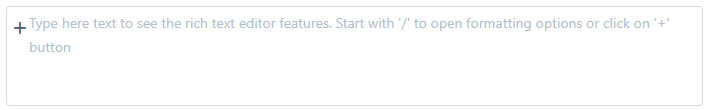

According to the above text, pressing "/" or "+" on the keyboard visible in the field will present formatting options. They are as follows:

* Upload image, video, audio, pdf - allows inserting an image into the edited text area.
* Link note - adds a redirect to another page or a specific location on the frontend.

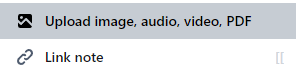

* Todo List - creates a checklist with checkboxes (V) for itemization.
* Bulleted List - creates a bullet-pointed list using dots.
* Ordered List - creates a sequentially numbered list starting from 1.

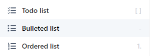

* Table - generates a table.
* Quote - places the text in italics, often used for quotations.
* Code block - formats the text to resemble pseudocode.
* Math equation (Latex) - allows inserting mathematical equations.

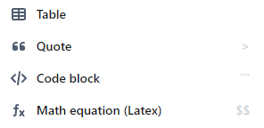

* H1 Big Heading - the largest heading, suitable for titles.
* H2 Medium Heading - a medium-sized heading for important but not the most significant content, such as subtitles.
* H3 Small Heading - the smallest heading style, slightly larger than regular text but the smallest of the three H headings.

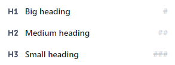

After filling in the fields in the admin panel with the necessary data, you should click on the blue "Submit" button to confirm. If you need to reset and clear all the entered values, you can do so by clicking the white "Reset" button.

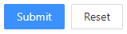

>[!WARNING]
>When you click the "Submit" button to create a new course, it will not be available for purchase on the front-end of the platform yet. Setting the product price and purchase options will be done in the subsequent steps during the course content editing. Everything will be described below.

## Editing an existing course.

Editing can be done in two ways - theoretically, after clicking the "Submit" button when adding a new course, the administrator remains on the page with its details, allowing for editing and modifying the data.

The second situation is accessing the course list as described above and clicking on  a specific course. Both editing screens look the same.

It can be observed that during course editing, numerous new tabs appear on the side. For example: Product, Media, Categories and Tags, Curriculum, SCORM, Access, Certificates, Surveys, Statistics, Enroll User Without Account.

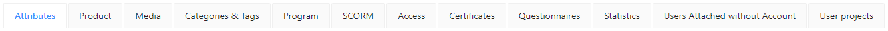

>[!WARNING]
>The visible attributes may vary in terms of their placement or naming.

1. **Product**

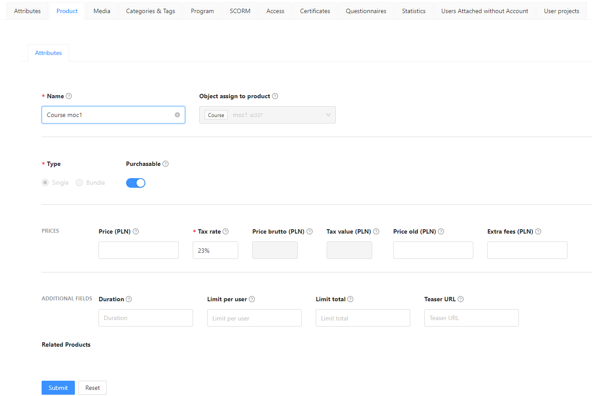

In this tab, the administrator can provide the necessary settings to turn the created course into a purchasable product that can be added to the user's cart and subsequently paid for. Here is the information that needs to be filled in this tab:

* Name (required) - It should remain the same as the course name.
* Object assigned to the product - Grayed out, unchangeable field that should indicate that the object is a Course.
* Type (required) - Also grayed out radio buttons, with "Single" being the default selection.
* Available for purchase - A switch button that needs to be activated by clicking to make the course available for purchase.
* Price - Enter the net price of the course, excluding VAT. The price should be entered in cents, but below, there is a hint indicating the equivalent amount in PLN.
* Tax rate - Enter the tax rate as a percentage. The value can be freely changed, and the system will calculate the tax for the net price and perform the necessary calculations. The tax rate can include decimals and should be written with a dot, e.g., 8.5%.
* Gross price - The price of the course including VAT.
* Tax value (required) - Grayed out field that provides the nominal value of the VAT tax.
* Old price (strikethrough) - Useful option for proportional pricing on Startup Academy. You can enter a previous, higher price to indicate an ongoing promotion for purchasing the course. If:
* The price is the same as the base price - There is no strikethrough, and only one price is displayed on the front end.
* The strikethrough price is higher than the base price - The front end displays the strikethrough price as a "promotion."
* Extra fees - If there are any additional fees for participating in the course (e.g., paid software required during the course but not included in its price), enter them in this field.
* Duration - Once again, enter the duration of the course in minutes, hours, or days.
* Limit per User - This limit specifies how many times a user can purchase the product. For a course, it is generally advisable and meaningful to set this limit to 1 (although not always).
* Overall limit - Limits the total number of people who can purchase the course.
* Teaser URL - In case the "Available for purchase" switch button is unchecked, meaning the course cannot be purchased yet but is already visible on the front end, paste a URL (a link) in the Teaser URL field. This will redirect users on the front end to the specified URL. This option is useful when, for example, creating a Google Form to collect potential registrations for the course before it becomes available for purchase.

After clicking the blue "Submit" button, two new fields will appear in this tab since the product has been activated: Related Products and Description.

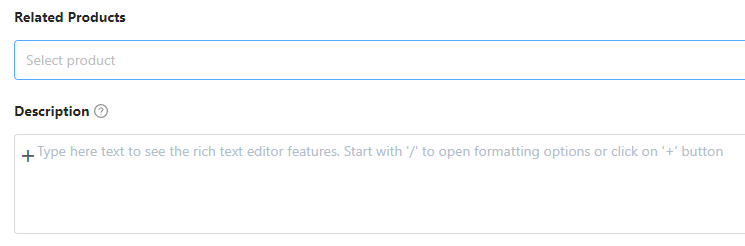

* Related Products - Here, it is recommended to enter or select the names of several other related courses to promote them and encourage customers to view and potentially purchase them.
* Description - The description should be consistent with the one created for the course, as mentioned above.

After saving the changes using the blue "Submit" button in this tab, you will notice that new tabs have appeared for completion, which are available after creating the product for purchase. These tabs include:

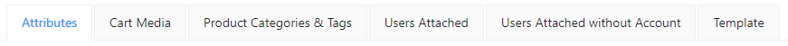

* Cart Media - In this section, you can add an image that will appear as a graphic next to the product in the cart during the purchase on the front-end website. This image will also appear in the "Related Courses" section on the front-end website. This is a very simple mechanism for adding an image or graphic that will appear next to the product name in the cart.

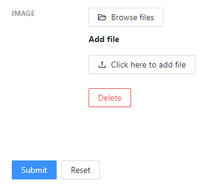

* Product Categories and Tags - Similar to categories and tags in the course itself, these should reflect the product's categories and tags to ensure that the product is searchable and associated with others. A simple tab where you can select the appropriate category or multiple categories for the product using checkboxes. Categories are added in the Categories tab in the admin panel.

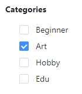

Tags, on the other hand, are selected from a dropdown list, choosing specific tags that are relevant to the product.

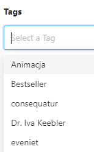

* Users Attached - From this section, you can add a registered user to a course without them having to go through the entire purchasing process. This option is useful, for example, for granting access to a user who experienced access issues after purchasing or for a user who has won a free course. In the field next to the "Users" label, start typing the first name or last name of the person you want to grant the course to for free, without requiring them to purchase it. If the person exists correctly in the admin panel system, they should appear on the list and be clickable. Clicking on their name will display their information in the table above, under the "Users" section.

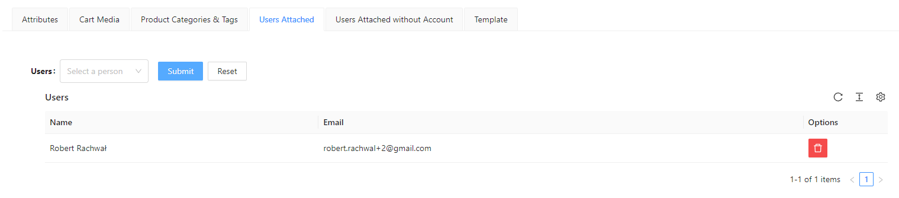

The user's Name (first name and last name), Email, and Options are displayed. Under Options, you will see a familiar icon for removing the user from the list.

* Users Attached without Account - Similar to the previous option, but with the difference that you enter an email address, and the person without an account will receive instructions to create a new account to access the course. It differs in that we add the email of an unregistered user to the list. They are then granted access to the course and are additionally required to create an account using the provided link before they can access the lessons.

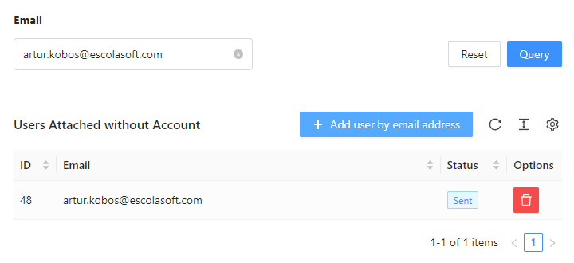

You should click on the blue button "+ Add User" next to the email address field. In the newly appearing window, enter the email address and then confirm by clicking the blue "OK" button. The added person will appear on the list, similar to the functionality described above, with granting access to the course for users already registered in the admin panel.

* Template - This is where you can set up informational emails or a template for a course completion certificate, allowing users to generate, print, and possibly frame their certificate. In the simple window, if a template for an email or a certificate for course completion has been created and configured, you can select it from the list and click the "Generate" button. This will enable the creation of certificates for course participants.

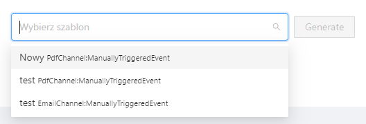

2. **Media**

In this tab, we can set an image, video, or poster representing the course and its properties. All files are added in a similar way to adding an avatar for a user. The tab has the following appearance:

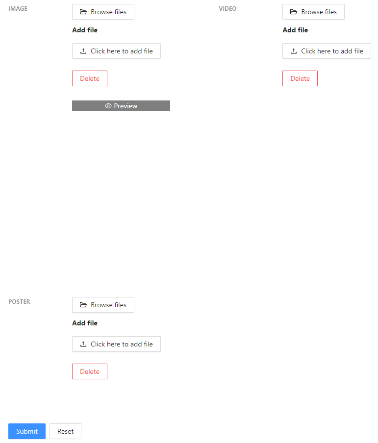

3. **Categories & Tags**

The process of adding and creating files is analogous to what has already been described for adding them as a purchased product and assigning them to users.

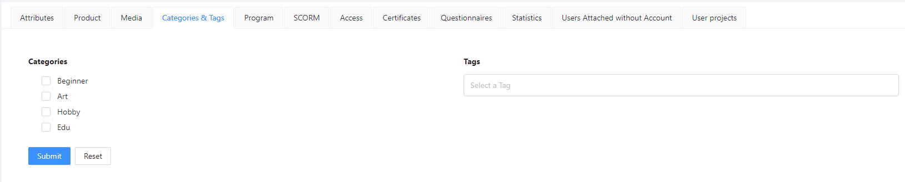

4. **Program**

This is the central place for all course content. Here, you add the course curriculum in the form of lesson outlines along with their components: text, images, diagrams, videos, interactive H5P quizzes, and more. The key is to construct the course and its elements in a way that allows learners to derive maximum value from it.

To get started, click the blue button "+ Add New Lesson."

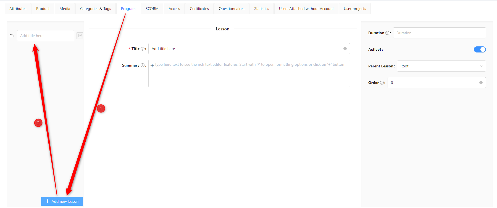

When describing the process of adding a new lesson in the panel, we have the following fields:

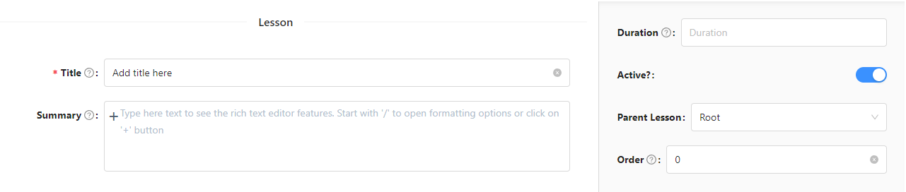

* Title (required): Enter the name of the lesson, e.g., Introduction, Preliminary Concepts, etc.

* Summary: This is a space to provide a brief description of the topic or content covered in the lesson, giving the learner an overview of what to expect.

* Duration: Specify the estimated time needed to complete the lesson, as determined by the author. The duration can be indicated in minutes, hours, or days, depending on your requirements.

* Active?: This is a toggle switch. Disabling it will make the lesson visible on the course front-end, but learners will not be able to interact with the lesson content during its execution.

* Parent Lesson: Indicates the parent lesson of the nested lessons.

* Order: Allows you to specify the positioning of the nested lessons.

The Create and Delete buttons perform their respective functions as indicated by their names.

To add a topic to a lesson, hover your mouse cursor over the lesson, and a blue  button will appear next to it. By clicking the button, you can create a topic of your choice. To select a topic, hover your mouse cursor over the icon and click on any desired icon. The available options, from top to bottom, are:

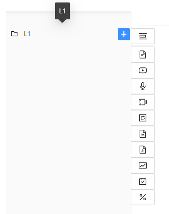

* 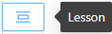 **Lesson** - Adds sub-lessons relative to the first parent lesson, allowing for the creation of a flexible structure. Administrators can set limits on the depth of lesson nesting according to their preference.
* 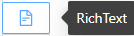 **RichText** - a text field for written content in the lesson.
* 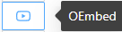 **OEmbed** - allows embedding a link from platforms like YouTube or Vimeo, which will be displayed within the lesson.
* 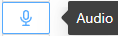 **Audio** - allows uploading spoken text by a narrator or music if needed; supported formats: *mp3, *ogg
* 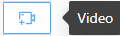 **Video** - enables adding video files to the lesson to enhance the presentation of certain topics using audio and visuals; supported formats: *mp4, *ogg, *webm
* 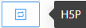 **H5P** - interactive exercises designed to test the learner's attentiveness during the lesson using simple and engaging puzzles. More details can be provided when expanding on the topic.
* 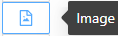 **Image** - allows uploading images, informational graphics, or diagrams to convey knowledge visually and aid comprehension; supported formats: *jpeg, *png, *bmp, *gif, *svg
* 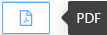 **PDF** - a commonly used document format, useful for creating presentations with pages/slides or presenting graphical summaries in a single file instead of individual files.
* 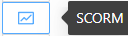 **SCORM** - adding an external multimedia presentation. More details can be provided when expanding on the topic.
* 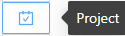 **Project** - enables users to upload files. The instructor creates a project and allows users to submit project files; supported formats: *jpeg, *.xlsx, *xls, *.docx, *doc, *jpg, *png, *pdf, *pptx, *ppt.
* 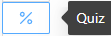 **Quiz** - exercises designed to assess knowledge with limited attempts or a time limit for completing the exercises.

When adding sub-lessons, you can see an informational tree view of the course structure. Similarly, the Order feature is useful when there is a need to change the sequence. The view of created sub-lessons looks as follows:

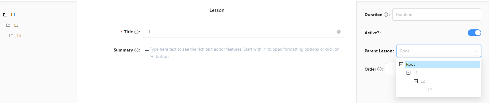

The right-side menu will be present when selecting each topic.
* Title (mandatory): The header name of the element. For example, if we are adding an illustration with bank charts, a logical title would be "Bank Chart."
* Active: Indicates whether the element is active and will be included in the course or not.
* Preview: Allows previewing the element within the course.
* Skip option: Enables skipping the element in the course. It means that it won't count towards the progress but can be viewed.
* Parent Lesson: From the dropdown list, select the specific lesson where the element should be placed.
* JSON Metadata: This opens a small editor window for editing JSON code. It's not recommended for non-programmers or those unfamiliar with the programming language.
* Description: It has an Open Editor button that allows adding additional text above the interactions to create a column of text and interactions.
* Introduction: Textual introduction that gives a starting point to the presented material.
* Description: Written content that enriches the presented content and expands on the topic.
* Summary: Text summarizing the discussed problem.
Regarding formatting the Introduction, Description, and Summary, it has been mentioned above.
The bottom part of the element editing window is consistent for each element:

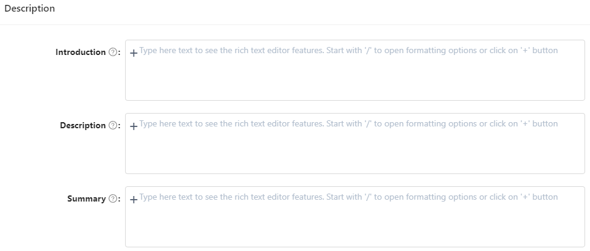

RichText: In the middle part of the editing screen, simply add the desired text, which will be displayed as part of the lesson.
The RichText editor appears as follows:

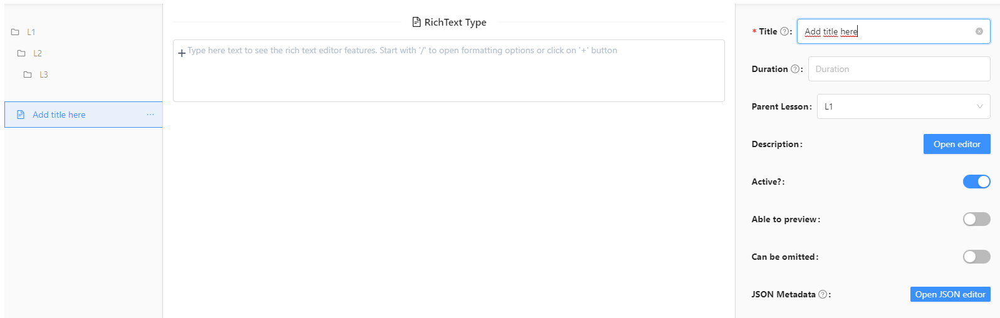

The module for adding external page links within topics. The editor appears as follows:

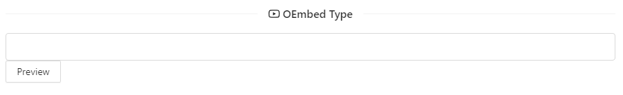

You can preview the added link to make sure that you are including the correct material in the course.

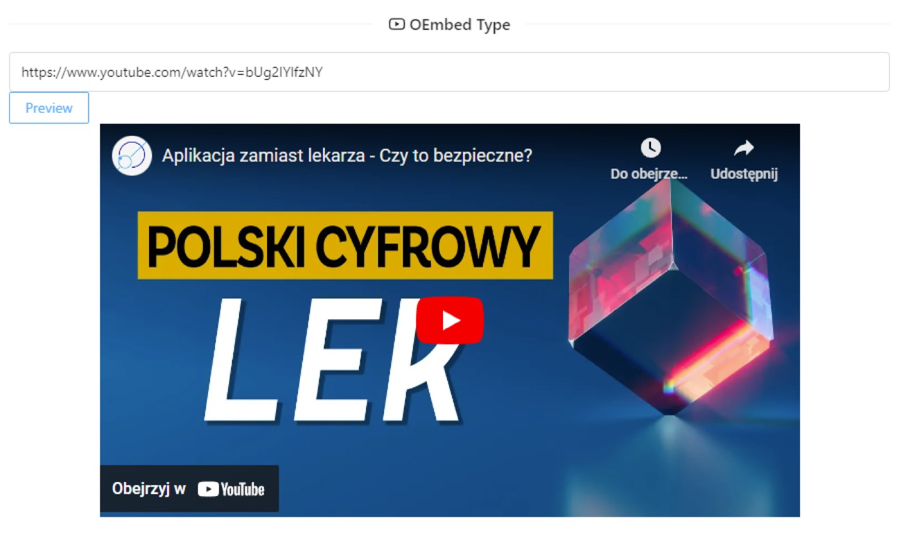

In this module, you can add an audio file to the topic. The most preferred format is MP3, which can be played in any web browser.

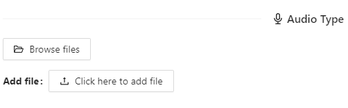

The same applies to videos, where the most preferred format is MP4, which can be played in most web browsers.

H5P - At the bottom of the editing window, you can see several places to add existing files or create new ones. Creating H5P quizzes takes a while and has its own separate, comprehensive creator windows, which will be discussed in the next section, specifically about H5P.

In the case of images, the editor is similar to audio and video. You select the desired image from your computer and display it in the topic.

PDF works similarly and has an editor for adding the desired file from your computer to the topic.

A multimedia presentation in the SCORM format can only be selected if you have previously added an external file to the SCORM library. To add it to the topic, it must be in the library, as the topic has a dropdown list of files already available in the platform's resources.

In the project, the trainer selects a person from the dropdown list to whom they want to assign a task. It can be a single person from a group or multiple individuals.

In the Quiz topic, we have two editors where we can set the number of attempts for the exercises and the time limit for completing the quiz. However, before that, you need to save the page in order to add quiz exercises to the topic during the editing process.

After saving, the topic editor expands to include a button for adding quiz exercises and a dropdown list of available quiz exercises to choose from.

After clicking the add button on the right side of the screen, a window for selecting quiz exercises opens up.

The number of lessons and topics depends on the methodological approach of the course creator.

5. **SCORM**

Adding a SCORM package involves adding an existing resource from the SCORM library on the platform. This module allows us to replace everything described earlier in the Program tab. In this case, only the multimedia presentation is displayed in the course without the structure of lessons and topics.

6. **Access**

Similarly to adding a User from the Product level, knowing the user's first name, last name, or email, we can easily grant them instant access to the course. This can be done as a reward, compensation, or for technical reasons, such as when something didn't work for them in their Customer Panel after purchase. Alternatively, we can add a group of users if we have a designated number of people to whom we want to provide free access to the course.

7. **Certificates**

In this section, we are able to preview, generate, and download certificates not only from a specific course but also from the entire Administrative Panel. Every user who completes a course should appear on the list for a specific certificate template. For more information on this topic, please refer to the chapter on Certificates.

Indeed, you can generate multiple certificates within a single course. This flexibility allows you to meet individual needs or create various personalized diploma and certificate designs. You can customize the content, layout, and design of each certificate to suit your specific requirements.

8. **Questionnaires**

By creating a survey with a question about how the course was liked, you can assign such a survey to the course right here, on this tab. Use a switch button to select the appropriate type of the pre-prepared survey. More about surveys can be found in the chapter dedicated to this topic.

9. **Statistics**

Upon entering this tab, you will notice a table with statistics regarding a specific user.

To display the minutes spent on topics by users in the course, you can use the switch toggle option labeled "Show minutes spent on topic."

The table below provides information about the date of course completion by users.

Below, there are also charts. These can include:

Earned revenue: The monetary amount spent by all users who purchased the course.
Users: A bar chart with options such as the number of people who purchased the course, the number of people who completed the course, etc.
Average time spent in a topic: Shows how much time students spent in a particular subject.
The platform can collect statistical information as needed, and in this case, the possibilities are vast. I recommend contacting the sales department to determine the specific parameters you require for your platform.

10. **Users Attached without Account**

We enter the email address, and a person without an account will receive a command to create a new account for themselves.

11. **User projects**

Moduł projektu służy przeglądaniu wysłanych plików przez użytkowników w wcześniej przygotowanym temacie o nazwie Projekt. Tutaj wyświetla się lista użytkowników, informacje o dacie przesłania pliku oraz przesłany plik z możliwością pobrania go albo usunięcia przez trenera.

The view of the uploaded files list is as follows:

