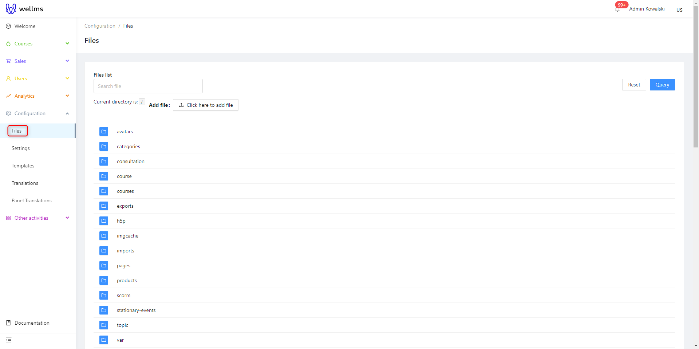
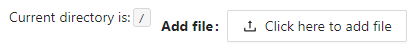
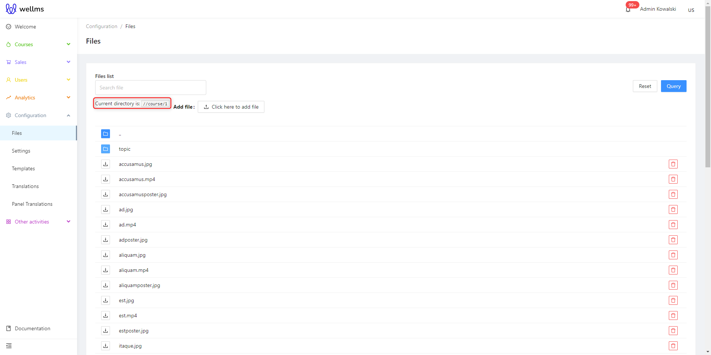
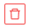
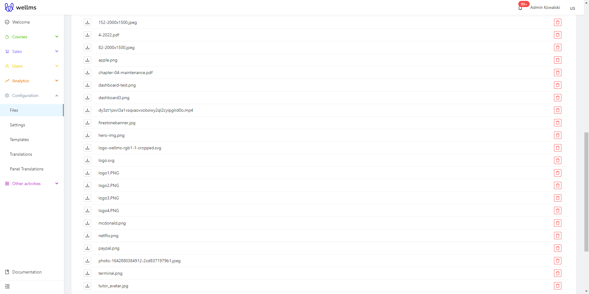
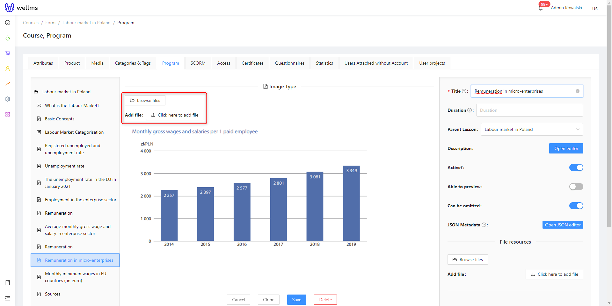
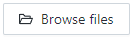
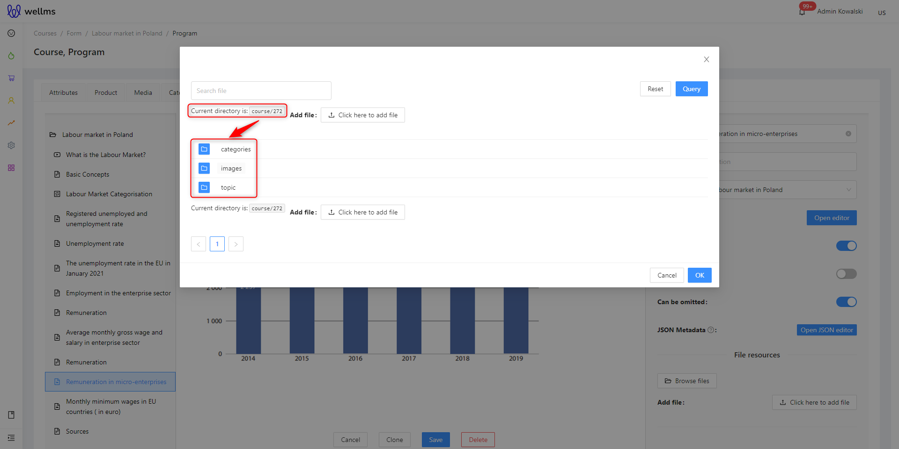
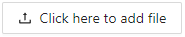

## Files

After logging into the Admin Panel, you should navigate to the "Configuration" tab in the left sidebar menu and select "Files" from the dropdown menu. 

The following view will appear before you:

The Files Library serves two purposes. First, it functions as a file and folder tree similar to any operating system. You can add files by clicking "Add Here" to use them in courses, webinars, or other areas, selecting them from the files uploaded to the Admin Panel rather than from your local computer.

The second function of the Files Library is the automatic saving of all platform files. When creating a course, an automatic course ID is generated, and all files added to the course can be easily accessed through this ID without having to browse through the entire course content.

If you want to delete a file from the Files Library, simply click on the red button on the right side. 

>[!WARNING]
>You cannot delete automatic folders because the platform creates them automatically and links them to elements added in other parts of the platform. Therefore, you won't find a delete function for folders.

In many modules of the platform, mainly when adding content, you can find a module for adding files. An example from courses is shown below:

By using the  option, we can add a previously uploaded file from the library or review the files already added to this course.

By using the second button , you can directly add a file from your local disk.
