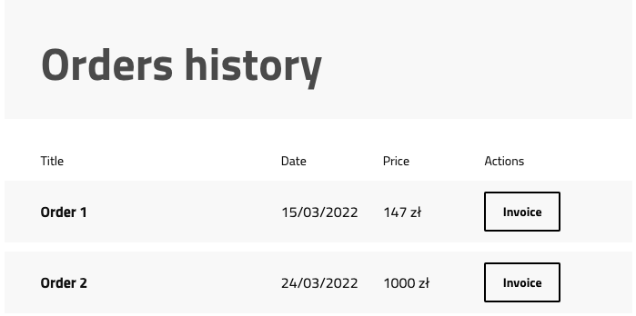
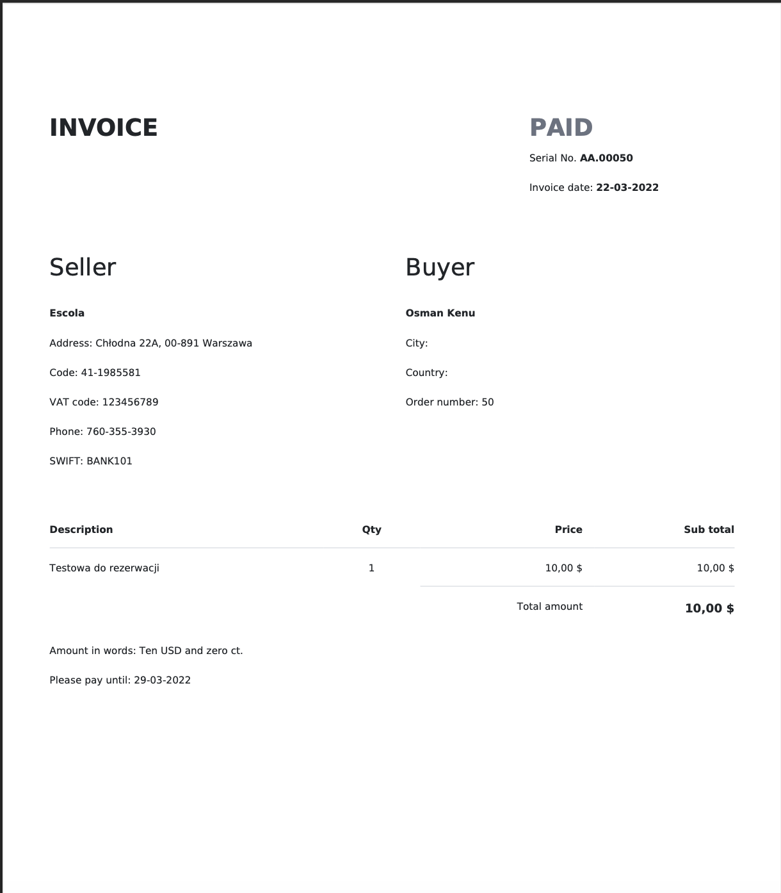

# Admin panel documentation

There is no way to preview invoices in the Admin Panel.

Configuration of this package is not yet available from the Admin Panel. 
See the configuration in the [README](https://github.com/EscolaLMS/Invoices#config).

# Front app documentation

To view invoices, access your user profile and go to the *My Orders* section.

The user can view invoices from orders.

The invoice is downloaded in `pdf` format.

