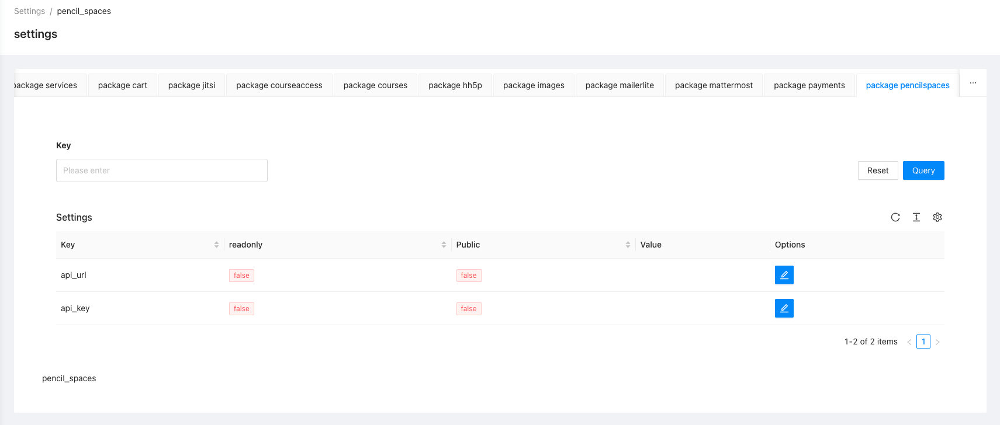

# Pencil-Spaces

## Configuration 

This package can be configured in the Admin Panel. To do this, select the *Settings* and then navigate to the *PencilSpaces* tab.

You need to set `api_key` and `api_url`. Read [here](https://intercom.help/pencil/en/articles/8051033-how-to-find-your-api-key-on-pencil-spaces) how to find these values. 
