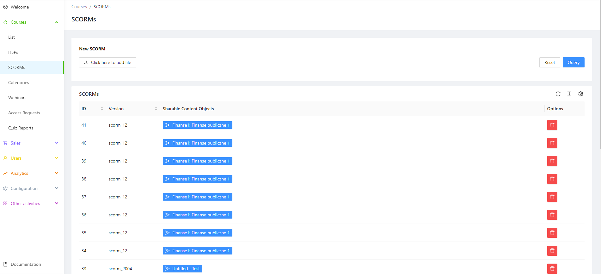
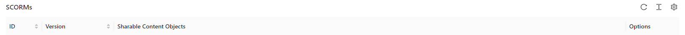
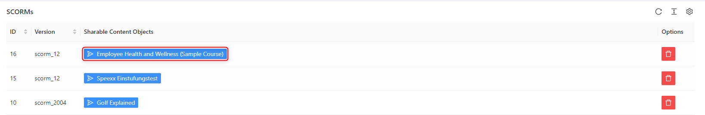
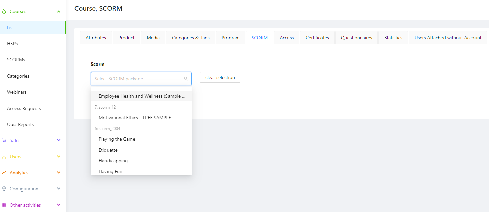
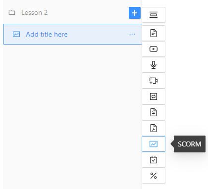
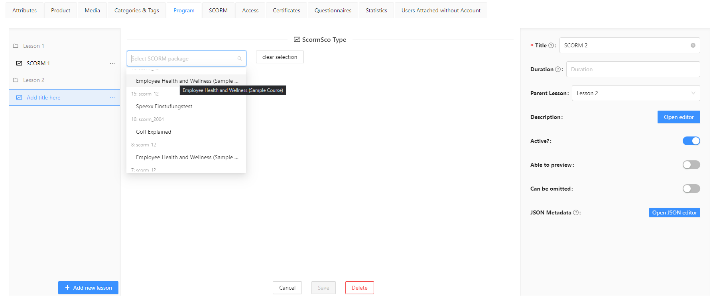

## "SCORMs" navigation bar in the admin panel.

The SCORM module is a library of SCORM packages. We add the existing package with multimedia presentation to the library, or directly within the created lesson. This section contains information about all multimedia presentations embedded within the platform.

New SCORM  It allows adding a SCORM package from the disk.

The sorting of the SCORM list can be done based on:

* ID - The unique identifier assigned to the SCORM.
* Version - Refers to the version in which the SCORM package was created.
* Sharable Content Objects - The title of the shared SCORM package saved from the developer file. Additionally, clicking on the package name provides access to the preview of the included SCORM.
* In the case of this library, the options are limited to removing the package from the platform.

Sharable Content Objects:

An example preview of one of the embedded SCORMs in the library:

The platform is responsive and supports SCORM formats, including those specifically designed for mobile phone displays.

As a reminder, on the Ulams platform, we can add SCORM multimedia presentations in two ways:

1. Standard way, commonly used on most platforms, where the presentation serves as a complete course.
2. Ech topic within a lesson is a separate SCORM presentation, integrated with various other interactions and content creation capabilities within the platform, all within a single lesson.

We choose the first option instead of the Program tab, meaning that we add the uploaded SCORM to the library, and it becomes a ready-to-publish course.

In the case of the second option, we choose to add SCORM from within the topic of the lesson we are creating:

The selection from the library is identical in both cases.

