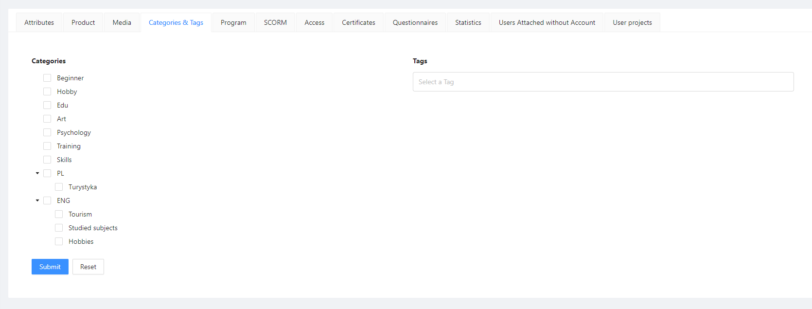
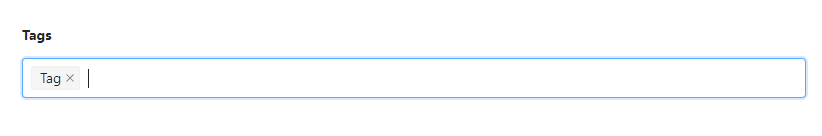

## Tags

Tags on the platform are used in various contexts. For instance, tags enable the categorization of content, such as courses, webinars, consultations, or products, allowing users to easily find and browse related information.

Tags on the platform can be created in each module that has positioning for end-users. You can find it in the Categories and Tags section.

The above example demonstrates adding tags to a course. Using this module is very straightforward. In the right text editor, type any sentence or word and press the "Enter" key on your keyboard to confirm.

