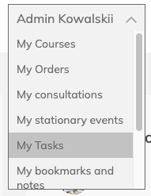
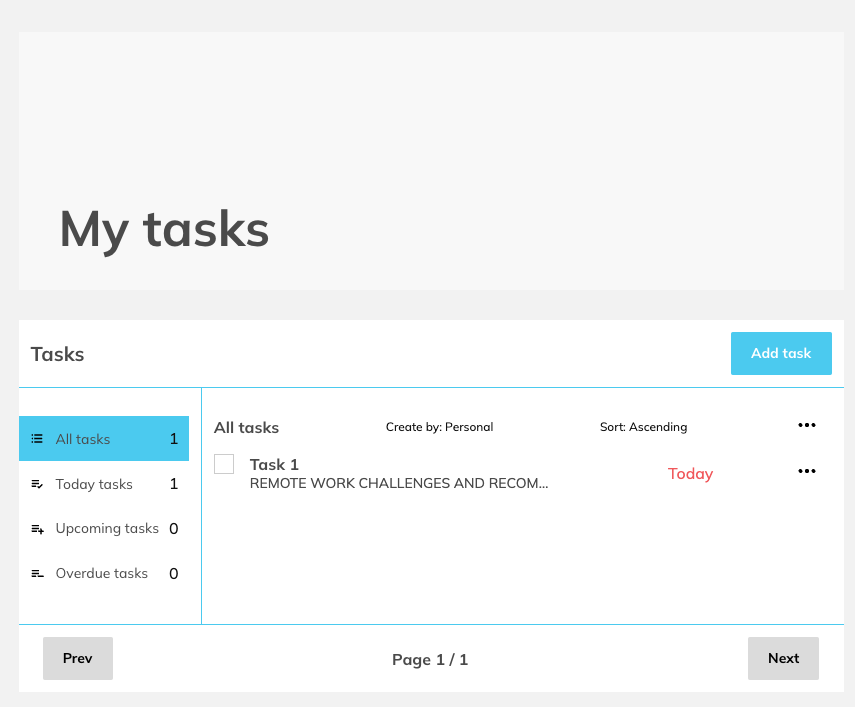
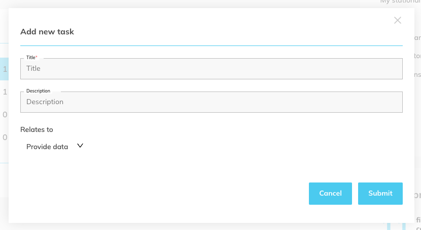
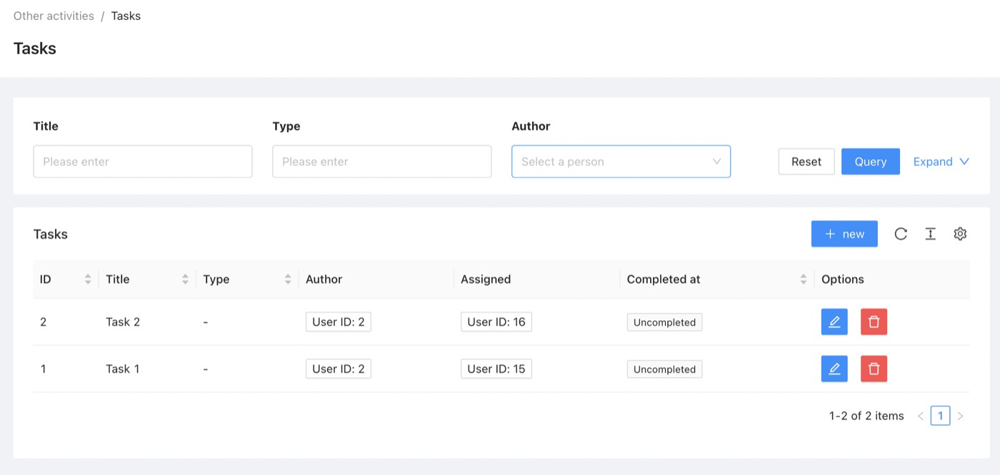
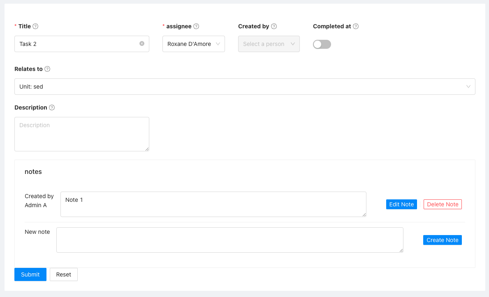
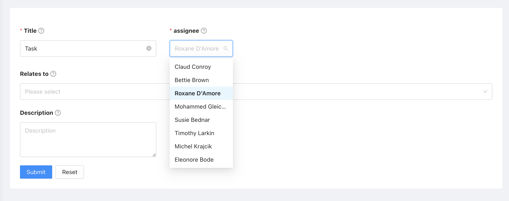
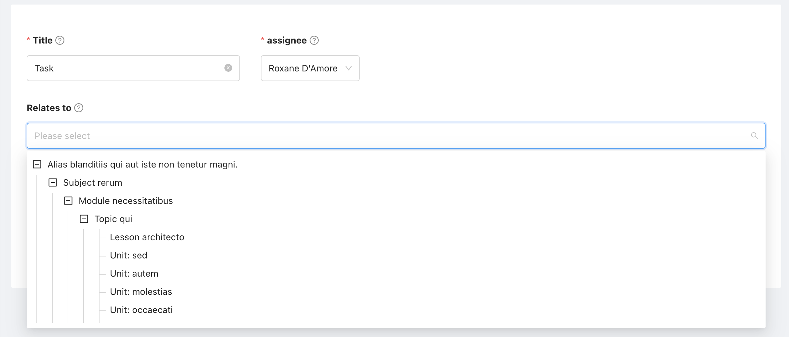
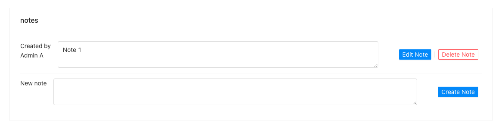

# Front app documentation
To view saved tasks, access your user profile and go to the "My Tasks" section.

The user can view all tasks or filter by time (for today, upcoming, overdue). From the list the user can add, edit or delete tasks. The user can also mark tasks as completed or send a request to check the correctness of a task.

When adding or editing a task, the user can choose which resource the task applies to.
From the frontend application, users can create only their own tasks, without the ability to assign tasks to other system users.

# Admin panel documentation

## Tasks

The task list allows you to search by task title, type of assigned resource and author. 
From the list you can also access the form for creating and editing a task, and delete a task.

From the admin panel, you can create and assign tasks to users.

Assigning a user

Assigning of resource

## Task notes
From the task form, you can also create notes. Notes can be created by the person who created the tasks or by an assigned person.

