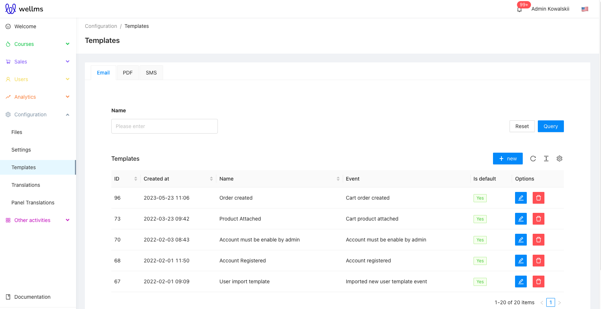
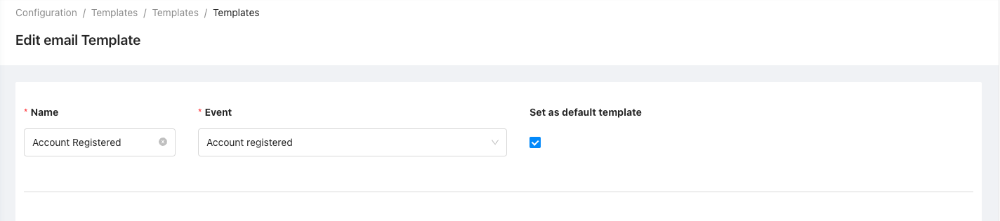
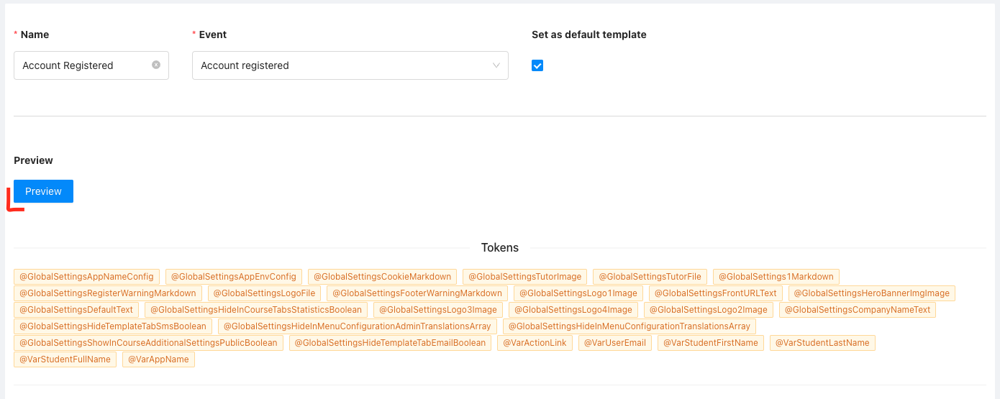
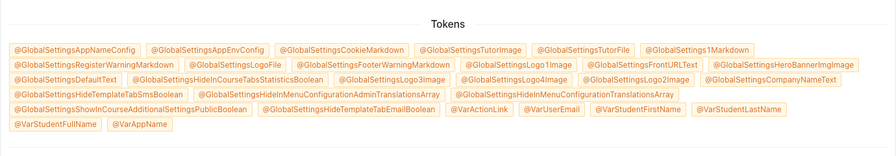
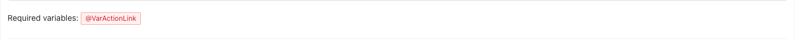
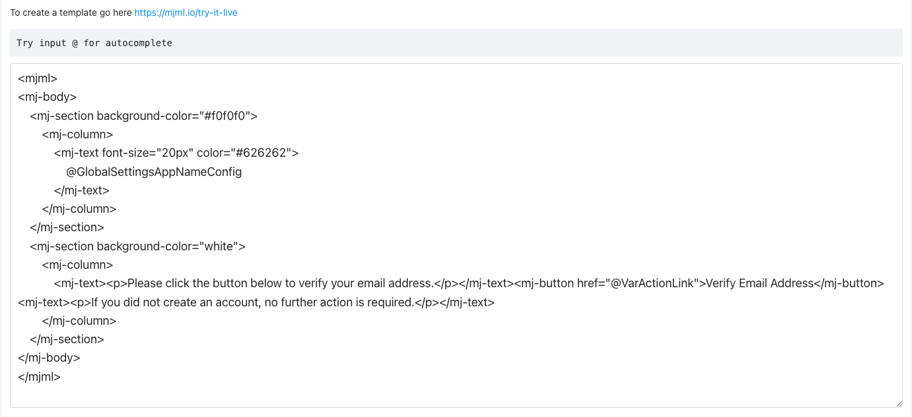
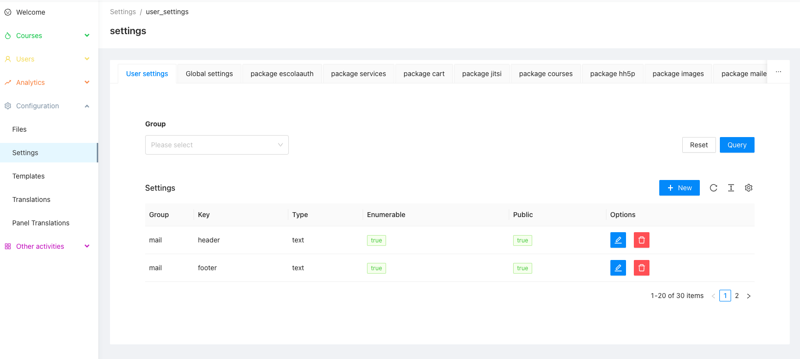
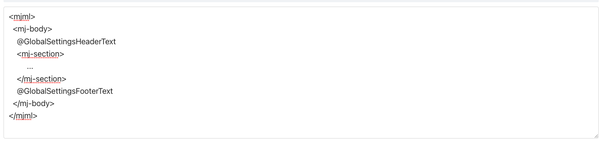

# Admin panel documentation

This package is an extension of the [Template package](https://github.com/EscolaLMS/Templates/blob/main/ADMIN.md) and is used for managing email templates.

Templates are defined in the *Templates* and *Email* tabs. From the template list, you can create, edit or delete a template.

Each email template has a name, an event, and you can set the template to be the default.
Sending an email is only possible for the default template.
The list of events available for selection may vary depending on the installed *ulams* packages. Each package emits its own events.

Clicking the *Preview* button will send an email to you. The values of the variables will be mocked.

When defining a template, you have variables to use. There are two types of variables global and event-defined. Global variables store general, system-related information, personalized variables store information directly related to the event.
Variables use a convention, with the @ sign before the variable name, to use a variable in a template you need to put the @ sign and the variable name, e.g. @VarSimpleName. 

The variables that are in the *required variables* section are the ones you must use in your template.

Mjml is used to create the content of an email.

You can use *Settings* to save recurring parts of the template, e.g. footer or header.  
Just define new variables in the *mail* group with the mjml code and then use those variables in the template.

## Visual editor

Above the MJML code, the *Code* and *Visual* switch opens a block editor for the same MJML. It works with
the mouse and fully with the keyboard: the *Structure and keyboard tools* panel adds, moves, removes and
edits blocks (arrow keys in the structure, Alt+Up and Alt+Down to move, Delete to remove, Enter to edit a
text or choose an image, Escape to stop editing text) and announces every change to screen readers.
Images are uploaded to the tenant storage and need alternative text (or an explicit "decorative"). Shared
parts (`@GlobalSettings...`) are locked: edit them in *Settings*. The default templates carry the `lang`
and `dir` of the application language on `<mjml>`, so they do not trigger the `missing-lang` warning.
Details and the key map: the *E-mail* page of the operator documentation, section *Visual mode*.

## Languages

A template can be written for one language (*Language* field of the form, `en`, `pl` or `zh`). The *Languages*
panel on the template page lists the languages of the event, marks the missing ones as *Missing translation* and
creates a translation as a copy of the template you already have. An e-mail is sent with the default template of
the language of the course, else of the academy's default language (`global.language`), else English, else the
template without a language (the ones that existed before). New tenants are seeded with English, Polish and
Chinese defaults (`ulams_templates_email.seed_locales`); existing tenants keep what they have. Details: the
*E-mail* page of the operator documentation, section *Templates per language*.

