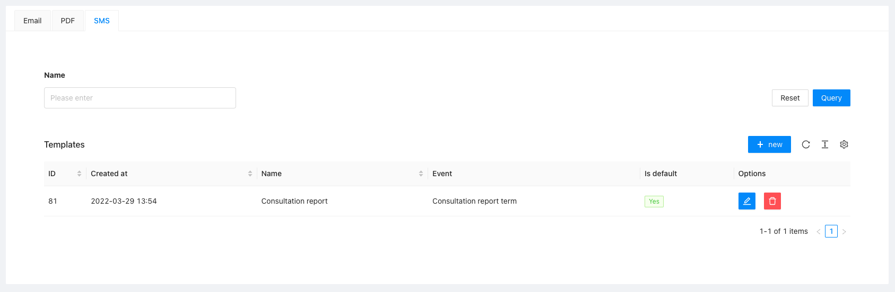
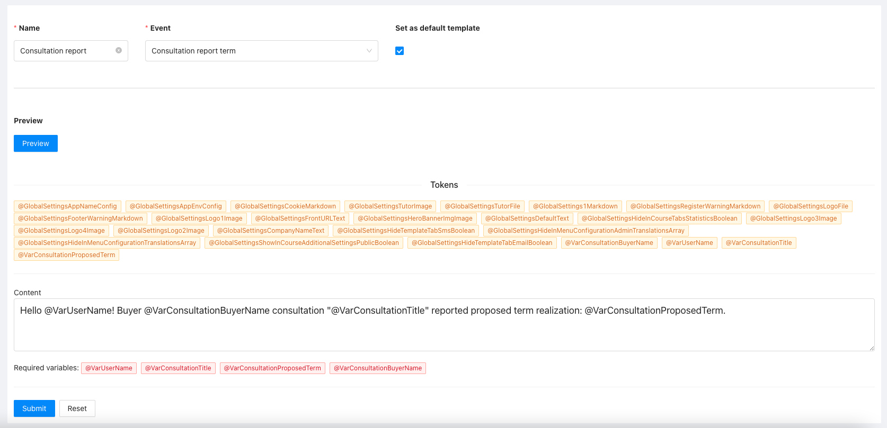
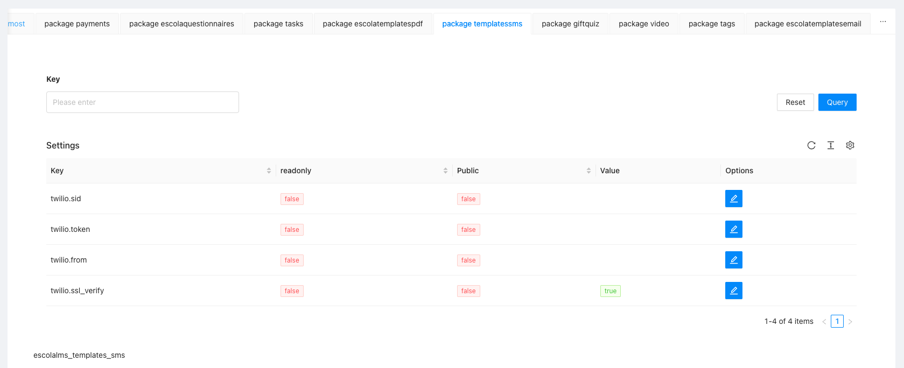

# Admin panel documentation

## Templates definition

The administration panel is used to manage SMS templates.
If the event does not have a default template defined, SMS sending will fail.

Templates are defined in the "Templates" and "SMS" tabs.
From the template list, you can create, edit or delete a template.

When defining a template, we have variables to use. There are two types of variables global and event-defined.
Global variables store general, system-related information, personalized variables store information directly related to the event.

Variables use a convention, with the @ sign before the variable name, to use a variable in a template you need to put the @ sign and the variable name, e.g. @VarSimpleName.
The template must be marked as default for SMS sending to work.

## Configuration

Configuration with the SMS dispatch platform is also required for proper operation.
The connection can be configured in the Settings tab.
Configuration example for Twilio platform:

