## Topic Type GIFT.

It's worth looking at the quiz topic in Wellsm. To add it, you need to enter the course and, as usual, in the lesson and topic creation wizard, select the appropriate topic:

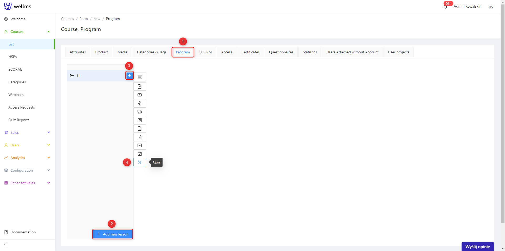

1. Select a program.
2. Add a lesson.
3. Add a topic to the lesson.
4. Now, we will discuss adding a quiz topic.

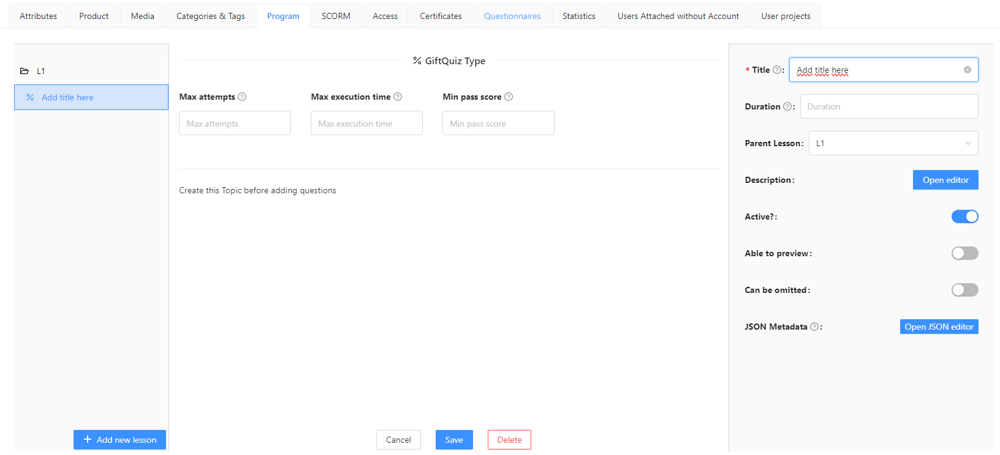

At this point, you can configure the GiftQuiz Type settings:

* **Max attempts** - sets the maximum number of attempts allowed for the quiz by the end user.
* **Max execution time** - sets the time limit for completing the quiz.
* **Min pass score** - sets the minimum score a user must achieve to pass the quiz.
* **Randomize order** - when enabled, both the order of questions and the order of the answer options within each question are randomized for each attempt. The same attempt always shows the same order (a refresh does not change it), while different attempts may get a different order. Disabled by default.

>[!WARNING]
> Create this Topic before adding questions.Questions can only be added after saving on this screen.

After saving, the topic screen looks like this:

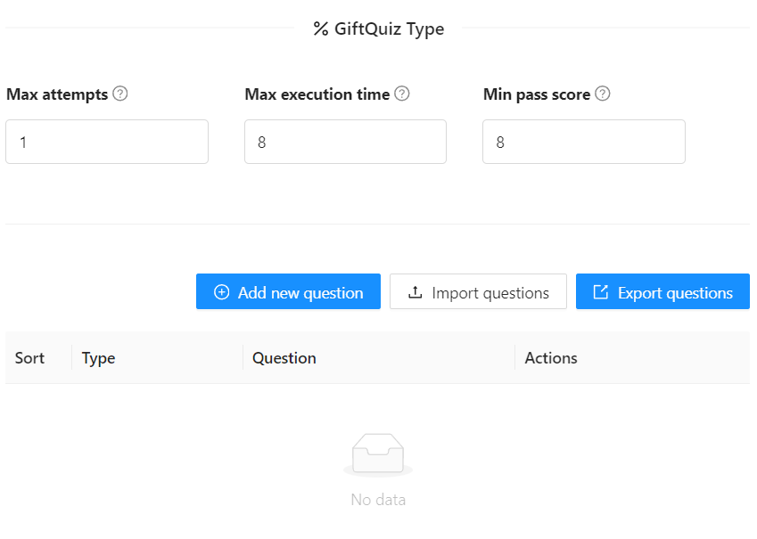

Similarly, you can add questions, import questions you already have from a form, and export questions created on the platform.

Let's start by adding questions and their types. After clicking  button, a question creation form appears on the right side of the screen.

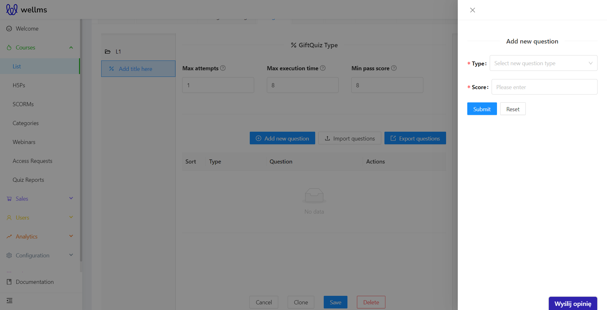

We can choose the following exercises for our quiz:

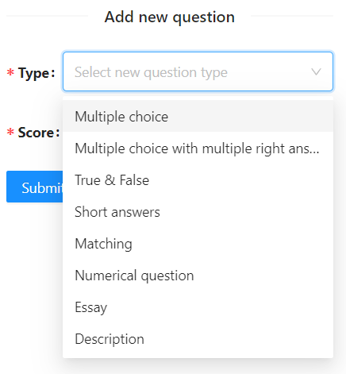

* Single Choice - Questions where the user selects one correct answer from a list of options.
* Multiple Choice - Questions where the user can select more than one correct answer from a list of options.
* True/False - Questions where the user selects "True" or "False" as the answer.
* Short Answer - Questions that require a brief written response from the user.
* Matching - Questions where the user matches items from two lists.
* Numerical question - Is a type of question that requires the user to provide answers as numbers. It could be a numerical response to a mathematical or physical question, such as providing the result of calculations.
* Essay - Questions that require a more detailed written response from the user.
* Description - A task that involves reading a description and answering questions related to the content of the description.

Now, let's go through how the editors for all exercises look like. Filling them out will be very easy to do. We select the exercise we want to add to the quiz from the list and fill out the form.

# Single Choice

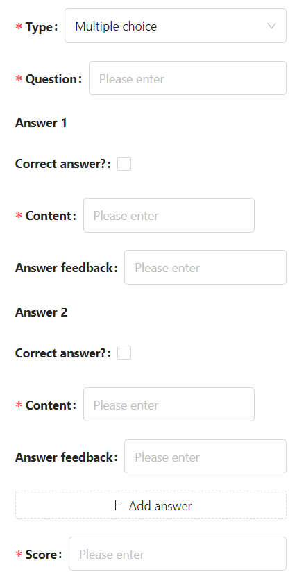

In this exercise, we can choose only one correct answer. To create an exercise, simply fill in the required fields; if optional fields are left blank, they won't be displayed in the quiz. However, it's always advisable to provide feedback for the user.

If you need to add more answers, click at the very bottom of the form 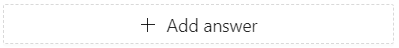

However, if you accidentally added too many questions, you can delete them by clicking the icon 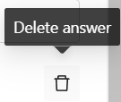

At the very end, add the score for the exercise. In the case of this exercise, it will be automatically calculated by the platform 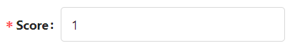

# Multiple Choice

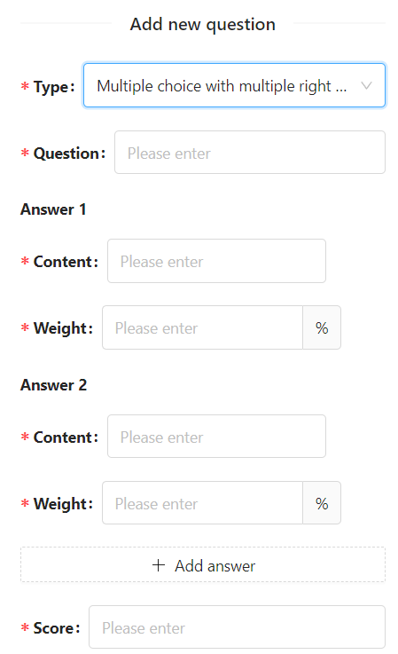

Fill out the form according to the required fields. In comparison to the previous exercise, you can add multiple correct answers here and allocate the percentage score for each correct option accordingly 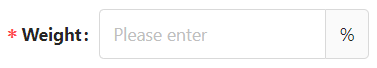

This task also undergoes automatic calculation of the final scores obtained by the end user.

# True/False

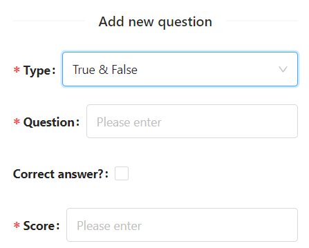

This is a traditional true or false exercise. After completing the question, you only need to mark whether it is true or false. This task is also automatically calculated by the platform in terms of the score.

# Short Answer

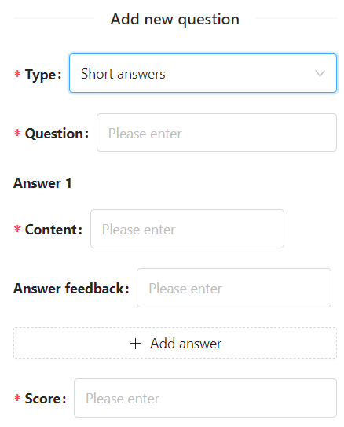

After filling in the required fields, you can optionally add feedback for the user. It's important to note that this type of exercise should be manually evaluated by the trainer based on the user's response.

# Matching

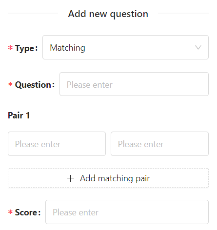

This exercise allows matching words or sentences to corresponding pairs. You can add as many pairs as needed. This exercise is automatically assessed by the platform.

# Numerical question

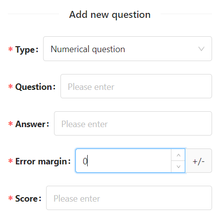

This exercise is used to test computational knowledge, suitable for mathematics or physics. You can set a margin of error for answers in the exercise, and the results are automatically calculated by the platform.

# Essay

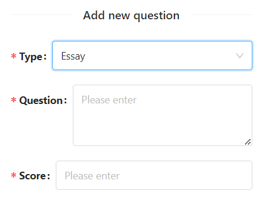

We fill out the form with the required written task and assign a possible number of points to be obtained. This exercise requires manual assessment by the trainer after receiving a written response from the user.

# Description

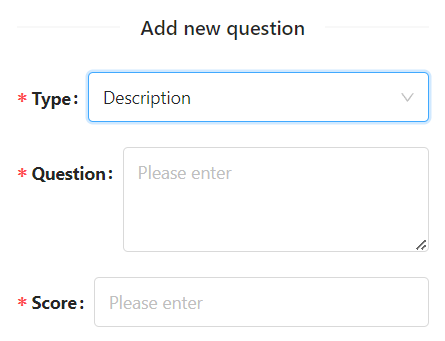

In this case, it's the same as in the previous exercise. You need to add the task and assess the exercise manually.

## The remaining options after creating the quiz

Once all the necessary questions have been created, we can review the entire quiz and make any necessary changes.

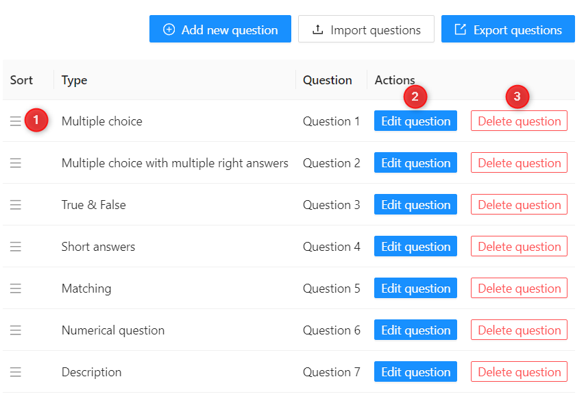

1. Using the icon with three horizontal lines in the "Sort" column, we can rearrange the order of the created exercises.
2. With this button, we can return to the form of the created exercise and edit it as needed.
3. By clicking this button, you can delete the exercise. Be cautious, as clicking it will immediately remove the exercise from the platform.

The "Type" indicates the type of exercise used, while "Question" is the title created by us in the form of the added exercise.

If necessary, you can export the created questions to your disk for archiving or moving them quickly to other courses.
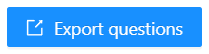

After clicking the export button, a selection window appears with a dropdown list of created questions.

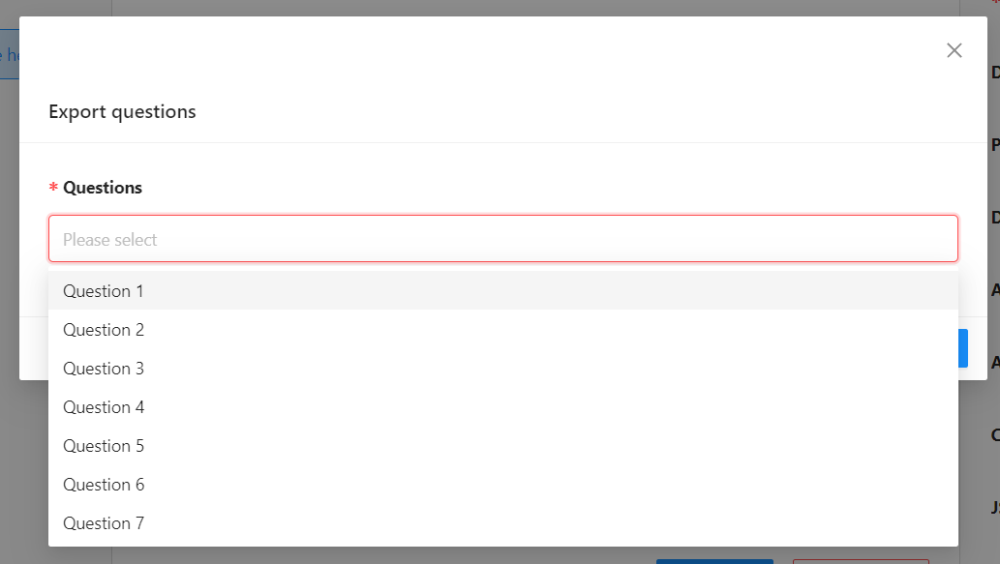

We select the questions by clicking on them. Then, at the bottom, click the OK button.

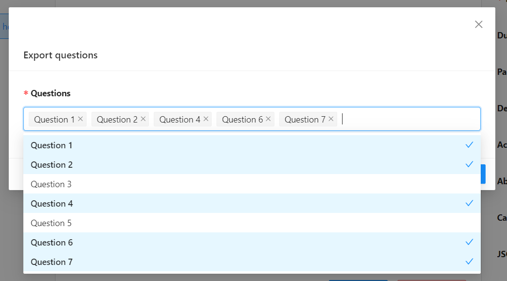

At this point, the selected questions will be downloaded to our disk in the xlsx file format.

The import works similarly. We select the exercise file from our disk and add the information from it to the platform.

>[!WARNING]
> Remember to save your work at the end of creating the quiz topic!
> 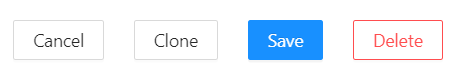

## Checking results using Quiz Reports.

To check the results, you need to go to the "Quiz Reports" tab in the platform's left-hand menu. Here, you can view detailed reports on learners' performance, including individual answers, completion status, and overall scores.

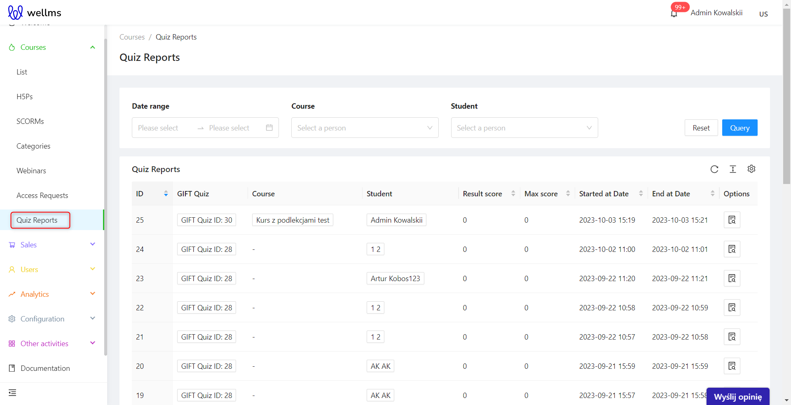

In this module, the familiar search functionality allows you to find exercise reports based on dates, courses, or specific users.

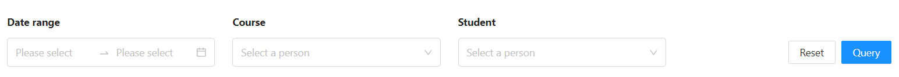

In the table, you search for the report you're interested in and can, of course, check all the information related to that report.

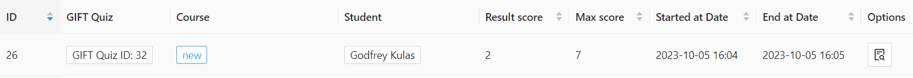

* ID - Assigns an individual number to the report.
* GIFT Quiz - General information about the attempt in a specific quiz.
* Course - Basic information about the course where the quiz is located.
* Student - Basic information about the student who took the quiz.
* Result and max score - User's obtained score and the minimum required score next to it.
* Start and End at Date -Start and end time of the quiz.
* Options - By clicking the icon, detailed information about the quiz can be obtained. Here, you can also manually assign scores to exercises that require it.

After clicking  on the detailed information about the quiz, you will be directed to the window where you can:

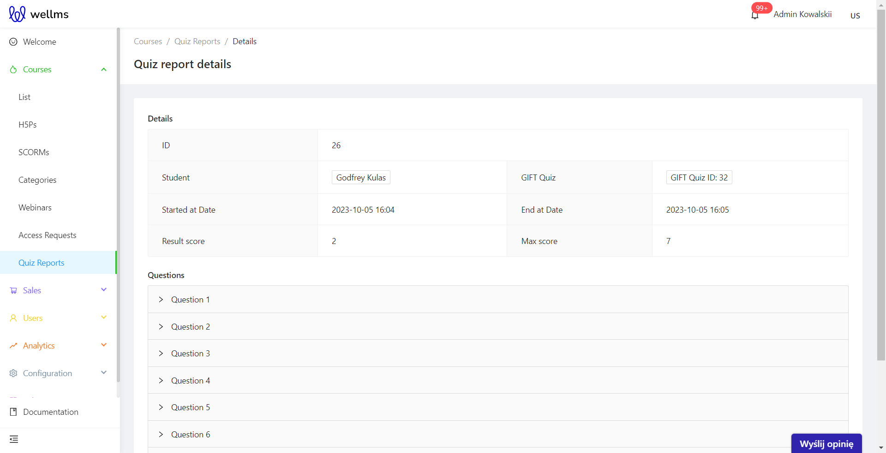

Here, you can see the accordion with all the questions. Upon clicking, information about the provided answers will expand, allowing you to edit the score for descriptive questions if necessary.

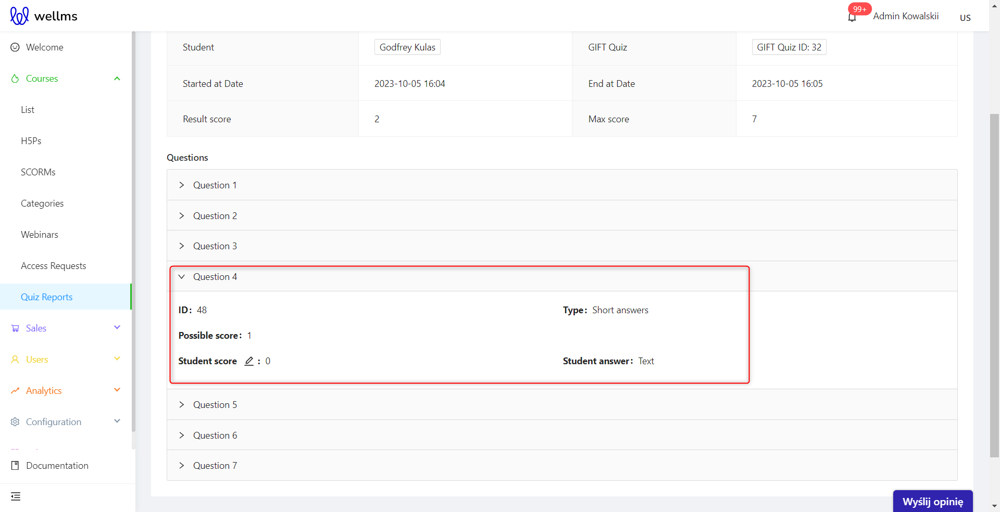

Clicking on  will open the option to edit the score for the question.

On the right side of the window, you can add points for the given answer.

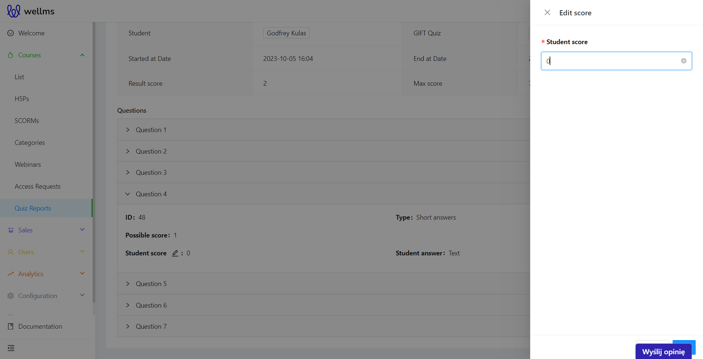

After manually grading exercises, the platform automatically adds the score to the summary and general overview.

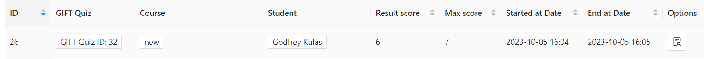

