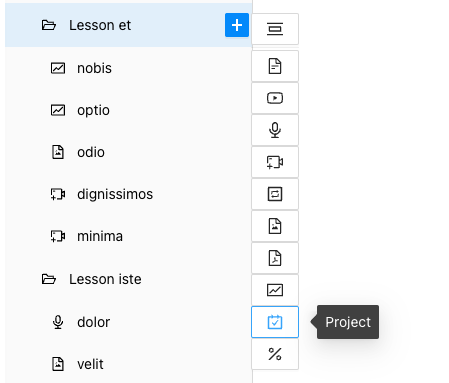
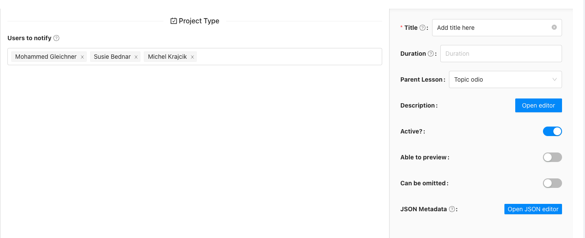
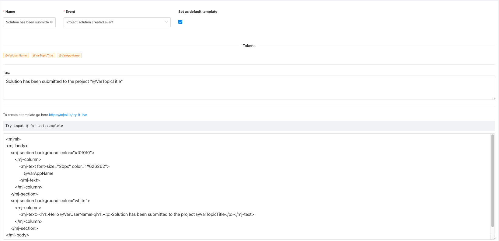
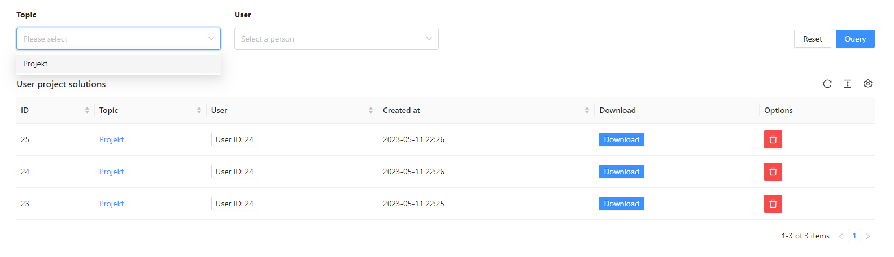
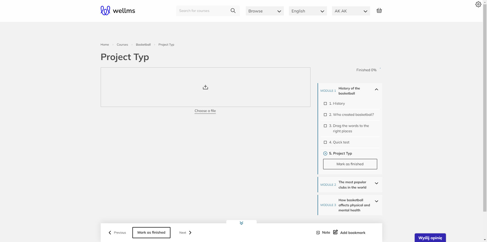
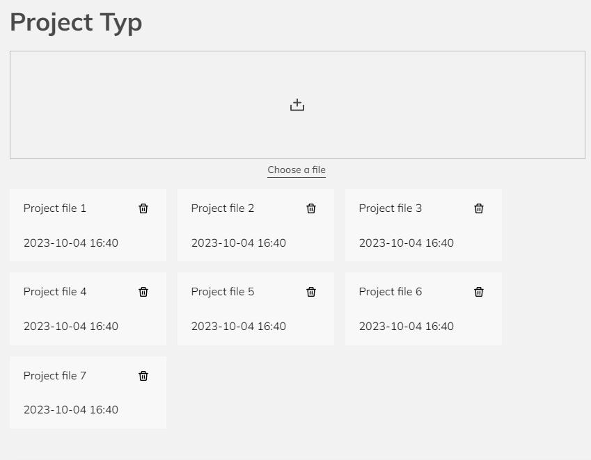

## Admin panel Topic-Type-Project

If you want the lesson to cover the topic of Project Type, simply select it from the list of available types.

You can choose the users to whom a notification will be sent when someone adds a new solution.

Remember to define the email template. 

In the course details, you will find the "User projects" tab. This module is used to view files uploaded by users in a previously assigned topic of the Project Type. Here, it displays a list of users, information about the date of file upload, and the uploaded file itself, with options to download or delete it by the tutor.

## Sample front-end appearance Topic-Type-Project

The end user's view in the course looks like this:

The end user has two options for adding a project file:

1.You can drag any file to the designated area for placement.
2.You can click 'Choose a file' to select a file from your computer.

After adding files, their quantity is displayed below the upload field. Of course, you can remove a file and replace it with a new one. Afterward, you can proceed to the next topic in the course.
