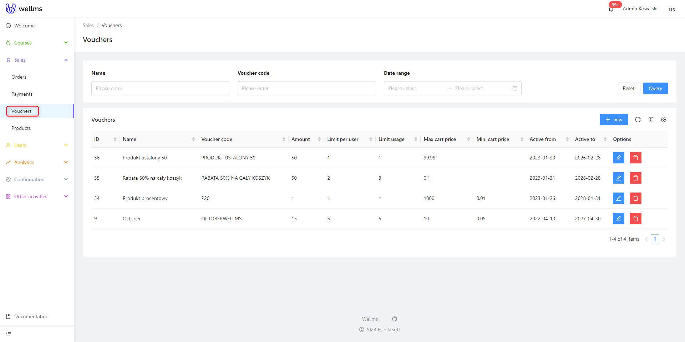
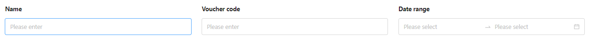
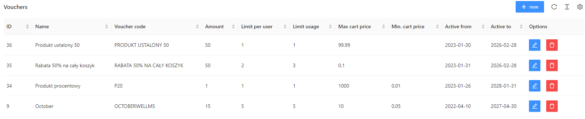
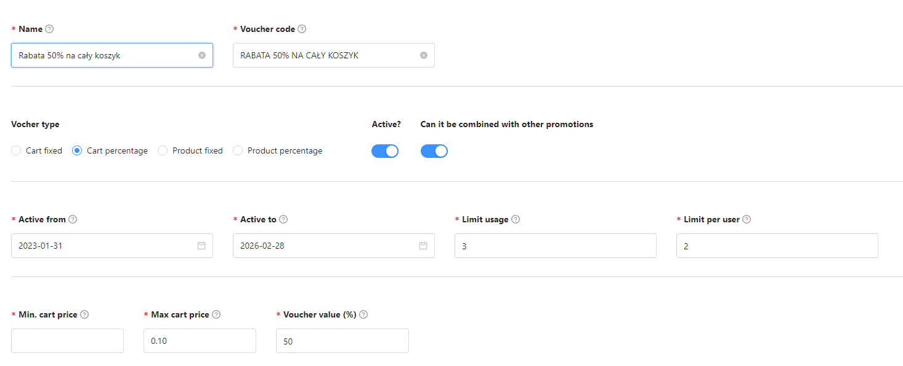
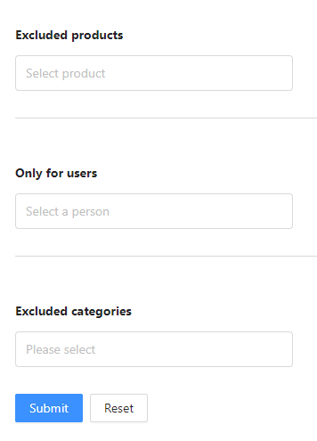

## Vouchers

After logging in to the Admin Panel, you should navigate to the "Sales" tab in the left sidebar menu and click on "Vouchers" from the dropdown menu.

Vouchers have three filters. The first one is the traditional Name filter, which filters vouchers based on their names. Next to it, there is a Code filter used for cases where voucher names are very similar. The last filter is based on the date range when the vouchers are valid.

Our vouchers have the following categories:
* ID, Name - as already mentioned, self-explanatory.
* Voucher Code - the code that users must enter in the shopping cart on the front-end to receive the discount.
* Quantity - you can set a limited quantity of vouchers if they are to be limited, following a first-come, first-served approach.
* Limit per User - the number of times a particular user can have the voucher.
* Usage Limit - how many times a particular user can use the voucher during purchases.
* Max Cart Value - the maximum order value in the cart to use the voucher.
* Min Cart Value - the minimum order value in the cart to use the voucher.
* Active From, Active To - as discussed earlier, choosing the start and end dates for the voucher.
* Options - editing vouchers and deleting them.

To add a new voucher, simply click on the blue "+ New" button.

The Voucher creator looks as follows:

* Name - Provide the name of your Voucher.
* Voucher Code - Again, the code that users must enter during checkout to receive the discount.
* Voucher Type: Fixed amount on the cart - A specific discount amount for the entire cart with products.
* Voucher Type: Percentage on the cart - A percentage-based discount on the entire cart with products.
* Voucher Type: Fixed amount on a product - A specific discount amount for a single product.
* Voucher Type: Percentage on a product - A percentage-based discount for a single product.
* Active - Indicates whether the voucher is available for use.
* Do not combine with other promotions - When the blue button is activated, the voucher will not be combined with other discounts/promotions on the platform.
* Active from-to - Sets the validity period of the Voucher.
* Usage Limit - Indicates how many times the voucher can be used on the platform.
* Limit per User - Indicates how many times a single user can use a specific type of voucher.
* Min and Max cart value - Sets the range in which the Voucher will be applicable.
* Voucher value - (when using a percentage-based voucher, no need to add % - the system automatically knows when to use which denomination).

  

**Excluded Products** - for which purchased products the discount will not apply (names appear after clicking, and you can choose items from the dropdown list with the mouse).

**For Selected Users Only** - useful fields for compensating for some user errors (e.g., the course was not purchased, but the funds were deducted from the account) or in the case of promotions or contests with Vouchers to be won. It applies the Voucher only to the specified users.

**Excluded Categories** - you can also select an entire product category instead of individually searching for items on the list to exclude from the discount.

After confirmation, a new Voucher will be created, and you can edit and modify it in the same way as any other existing Voucher. This allows you to make changes to the Voucher settings, such as the discount type, value, usage limit, validity period, and other related parameters, to suit your specific requirements or promotional offers.

