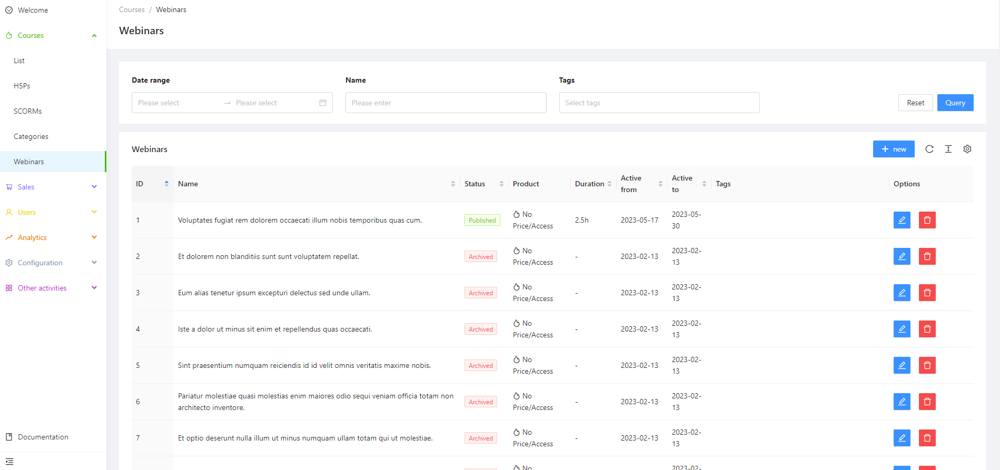
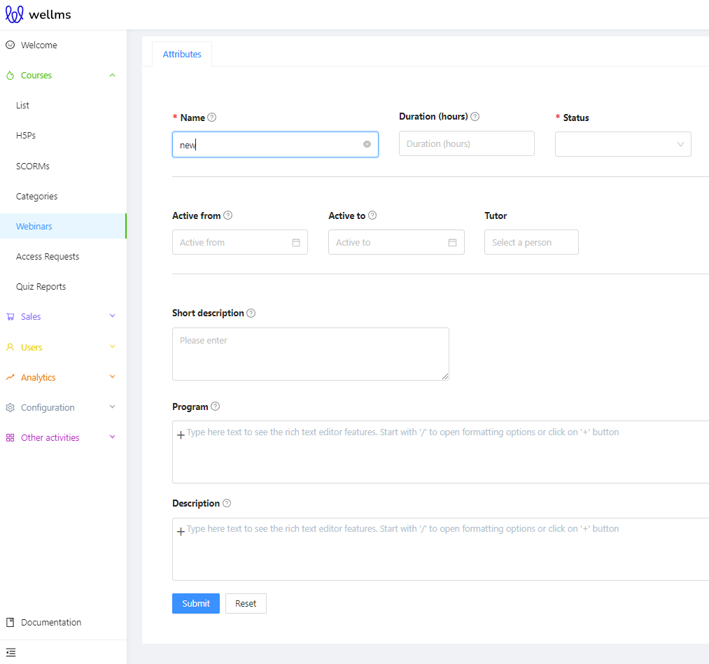
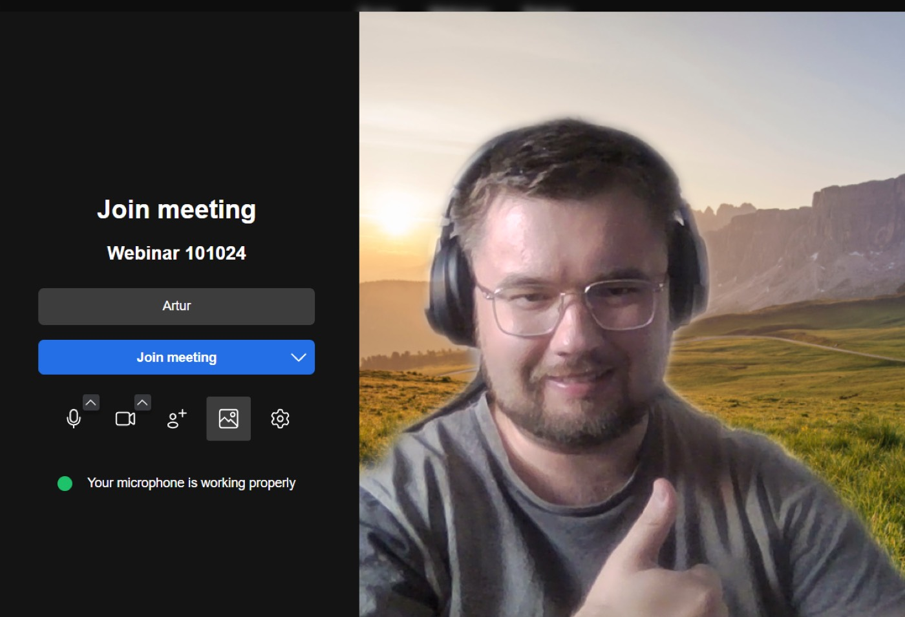
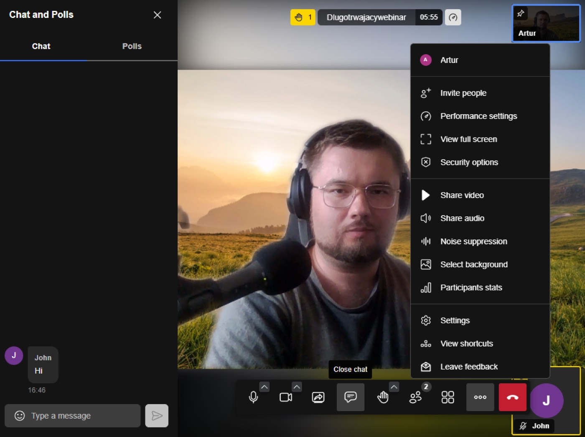

## Webinars

After logging into the Admin Panel, please go to the Webinars tab in the left-hand menu.

Above the space for the list of potential webinars, you will see three display options: Date Range, Name, Tags.

Individual webinar records are presented as follows:

We see the ID and Name as usual. There is also the familiar Status, Duration, Active from, and Active to. Also, Tags and Options.

## Creating a new webinar
To add a new product, press the blue button .

All the visible options have already been discussed and described, so no one should have any problems filling out the form in this simple webinar creator at this stage. Again, creating a new webinar by clicking at the end of the blue Confirm button adds additional tabs with the options for editing and configuring the webinar that have already been discussed: Product, Media, Tags, Branding, Save a user without an account.

The trainer, after creating the webinar, has access to it in their account profile. Meanwhile, a user can purchase the webinar and join it at the start of the session. Upon launching, the standard meeting configuration window will appear (it's identical for both the trainer and the user).

Once the settings have been configured, simply click the 
button.

The view shown above is a Jitsi room, which is a standard online communication room. More information about Jitsi can be found here: https://jaas.8x8.vc/#/pricing

>[!WARNING]
>To configure webinars in the LMS administrator panel, you will need API Key, Client ID, and Client Secret generated through the Google Console. You will also need a YouTube account with a channel that has the ability to livestream. More information on this topic can be found here: https://developers.google.com/workspace/guides/create-credentials?hl=en
