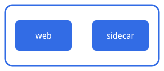

:::paragraph{#01m5gj6q4bt8dm1nptz4cgk492 cite="frg_podsareunits" objectives="01m5gj6q4bs9symrqeg0f9bvsr"}
A pod is one or more containers that share a network and storage.

:::

:::steps{#01m5gj6q4b4sf4tgnzmx2q5dst origin=author objectives="01m5gj6q4bs9symrqeg0f9bvsr"}
1. Start the pod: `kubectl run web --image=nginx`.
2. List pods: `kubectl get pods`.
3. Read the events: `kubectl describe pod web`.
:::
